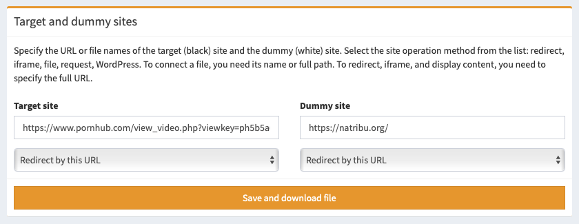

# Setting up filtering file

The easiest and most convenient method for installing a filter on a website is to download a ready-made filtering file. It will be generated for you automatically depending on the selected settings.

## What are target and dummy sites?

Target and dummy sites can be presented as file, domain or URL.

- **Target site**, sometimes called the "black" site - this is your valuable resource that we need to show real visitors and hide from bots, spammers and intruders.
- **Dummy site** also known as "white" site - it is a resource that cybercriminals and bots see instead of the target site. This could be a fake site, an error page, a third-party resource, or a honeypot.

When working with URL, be sure to specify the full link with `https://` at the beginning. When working with a file, do not specify a link to it, specify the relative path to the file.

## Site working methods

You can choose your method of work for the target and dummy sites. The service will automatically generate the optimal file for you, depending on the selected method.

> **Important!** If you change the way the dummy or target site works, you need to re-download the new filter file! If you change other settings, such as links or filters, you do not need to download a new file.

### Redirect by URL (302 redirect)

The visitor is redirected to the specified link using the `302 Found` header. This is the standard and most common way to work with redirects.

> It is not recommended to use 301 and 302 redirects in combination with other methods, as some ad networks may consider different delivery methods as site hacking.

### Redirect by URL and glue (301 redirect)

The visitor is redirected to the specified link using the `301 Moved Permanently` header. This kind of redirect is cached even if rotation is enabled in the stream settings.

> There is a belief that this redirect method allows you to glue your link to the target domain and the target domain will be shown in advertisements. We don't recommend believing these rumors.

### Redirect via separate page (meta redirect)

The user sees the "Your browser is being checked" page and is redirected to the target site three seconds after it is displayed. In this case, the browser does not receive direct 301 or 302 redirect headers, all redirects are performed using HTML.

> This redirect option is recommended if you're combining different methods of working, such as showing content for some paths and redirecting for others. This will avoid blocking an advertising campaign, for example, in Google with "Malware" mark.

### Redirect via script (JS redirect)

The user loads a page without content and is immediately redirected to the target site. In this case, the browser does not receive direct 301 or 302 redirect headers, all redirects are performed using JavaScript.

> This option can be used along with meta redirect to avoid blocking for "Hacked site". But this method may sometimes not work due to ad blockers in browsers.

### Open the file with the name specified

The script will open a file located on the server using the `include` PHP method. In the site field, you must specify the name of the file, if it is located in the same folder as the script, or the full path to the file. You can change this name on the fly in campaign settings without downloading a new file.

> Do not use standard filenames: `target.php`, `dummy.php`, `black.php`, `white.php`, `bl.php`, `wh.php`, `w.php` or `b.php` - to prevent an attacker from gaining access to your site with a simple search. If no file name is specified, `black-index.php` and `white-index.php` are used for the target and dummy sites, respectively.

When working with a local file on a target site, you can use the `{geo}` macro to open different target sites depending on the visitor's country. For example, `black-{geo}.php` will open `black-fr.php` when visiting from France. Use only with a target site and only when you specify a list of allowed countries.

### Show the URL in IFrame

The user sees a page with no content, on top of which an iframe opens in full screen with the site specified by the link.

> Not all sites support iframes due to security restrictions. When working with an iframe, it is recommended to open all links in a new window by adding the `target="_blank"` attribute to them, or allow displaying all sites in frames using titles.

### Show the URL contents (cURL)

The script loads content from by the link and shows it to the user. The `base` tag is added to the content, which replaces all paths to resources. So all resources (pictures, scripts, styles) are displayed on the site without the need to change its content. GET and POST requests are supported.

> There is a belief that the presence of the `base` tag in the content of the site negatively affects the approval of the site by search engines. We do not recommend listening to this nonsense. Displaying content via a link is the best way to work!

### Show the URL contents with no changes

The script loads content from by the link without changing paths and shows it to the user.

> When working with this technique, you must specify absolute paths with a domain for all resources: images, scripts, styles, fonts, otherwise they will not be loaded. The `action` fields in forms must also have absolute paths.

### Build into WordPress

You can embed your filter directly into your WordPress site. To install, upload the `index.php` file to the server instead of the same WordPress file. Be sure to disable caching plugins as they will interfere with the filter.

> **Important!** You cannot use WordPress on both the target and the dummy sites at the same time, you'll just have one site open. Use different working methods for the target and dummy sites. It is recommended to use WordPress on dummy site only. Use redirect or CURL for target site.

### Show blank page

Instead of linked content, a blank page with no content is displayed. Not even standard HTML tags for empty markup are sent. The response status is always `200`.
