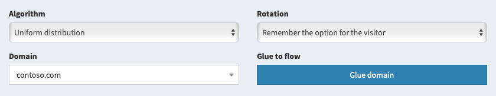

# Domain parking

We don't recommend using the system domain to work with traffic. You need to park your domains. There is no limit to the number of parked domains, you can use one stream with an unlimited number of domains.

## Basic principles

To park a domain and use it in flows, do the following:

1. **Add the domain to the system**. To do this, go to the "[Parking for scripts](/track-domain)" section of your personal account and enter the full name of your domain in the "Domain" field of the required type. You don't need to specify www, and you don't need to use http:// either.
2. **Configure domain DNS servers**. This action is performed in the personal account of your domain registrar. In the DNS settings of the domain, specify the use of free DNS of your registrar. If your registrar does not provide free DNS, we recommend using [CloudFlare](https://www.cloudflare.com), the settings are shown below.
3. **Configure your domain's DNS zone**. This action is also performed on the side of your registrar or CloudFlare. Go to the DNS zone editor in the registrar's personal account (do not confuse it with setting up DNS servers, you just need to set up a DNS zone).
  - Remove any existing A, AAAA, and CNAME records that point to the domain you want. For the root domain, their name will be @ or the domain name, for a subdomain, respectively, the name of the subdomain.
  - Add a new record of type A with this name and value shown in domain parking section
  - If you require IPv6 support, add a new AAAA record with this name and IPv6 address of your server
  - Do not add these entries for the www subdomain as its use is not supported. You can use the www subdomain as your target site pointing to your main server.
4. **Wait for the end of the domain binding**. Depending on various conditions, including the phase of the moon and the strength of the torsion fields, domain binding can take from several minutes to three days. You can check if the domain is linked by clicking the "Check" button.

The table of parked domains will show the current binding status. It is recommended to start working with traffic only if "Active" is indicated in the "Status" column. Within a few hours after the domain status changes to "Active", it receives an SSL certificate. A domain with an active SSL certificate gets a padlock in its name. You can speed up the domain check process by clicking the "Check" button (press no more than once every 15 minutes).

## Where to park?

The list of parking addresses is provided in the "Domains" section. You can view the list of records required for the domain by clicking the button with the server icon.

You have several options for parking your domains: the tracker's central server, your personal or team website storage, one of the front servers, or a PrivateFlare node.

1. **Central server.** For parking use A-record with IP of your server. If necessary, you can also add an AAAA entry with IPv6 of your server, if available. Parking at the central server is always available, installation of additional equipment is not required.
2. **Site storage.** Parking IPs are the addresses of your private or team server. For parking, you need to [create and configure a storage server](sites.md). Own storage reduces the chances of getting banned from advertising services and reduces the total number of problems with blocking.
3. **Front Server.** Parking IP addresses are the addresses of one of the personal or command front servers. A front server can be deployed according to the instructions in [site storage settings](/track-sites/setup). The number of front servers is unlimited.
4. **PrivateFlare.** Parking IP addresses are the addresses of PrivateFlare nodes. The list of addresses is usually downloaded automatically and displayed in the domain settings.

You can use any parking options at the same time. Within a couple of hours, the domain will be linked from one server to another and will receive an SSL certificate.

> Note to administrators: you should prepare a list of IP addresses where users will park domains. This list of addresses is specified in the tracker's general settings or in the personal and team site storage settings. The list of addresses is comma-separated, both IPv4 and IPv6 addresses can be used.

## Binding a domain to a flow

Typically, a random error is displayed on the main page of a parked domain, and all flows open at a character path. But you can glue any of the flow directly to the main page of the domain.

There are two options for this setting:

1. When working with a flow, select the required parked domain in its settings and click the "Glue" button. The flow link will begin to lead to the main page of the domain.
2. When working with domains, find the desired domain and click on the "Glue" button. The flow selection menu will open. Find the flow you want and click "Glue".

The same flow can be glued to any number of parked domains. When changing the domain in the flow settings, the old domain is not detached.

## Domain monitoring

The tracker automatically checks domain activity and attempts to monitor their registration and expiration dates. You can receive notifications via the email linked to your account or via Telegram. Notifications can be configured using the gear button.

- Domains are checked for correct parking every few hours. If a domain's status changes, the tracker sends a notification in real time. Only the "Error" status is of concern, "Active", "OK+SSL", and "Wrong!" are normal operating statuses.
- A summary of expiring domains is sent every midnight. The tracker collects domains that expire within a month or expired within a month and sends you a list of them. This feature is not available for all domain zones. Some zones, such as "info" do not disclose domain renewal dates via WHOIS.

To activate notifications in Telegram, you need any bot and the chat ID to which these notifications will be sent. You can create a bot using [@BotFather](https://t.me/BotFather). The chat ID is specified in the chat's profile in the Peer ID field. You can send notifications to multiple chats by separating them with commas. The group ID is specified with a minus sign.

## Features of parking in CloudFlare

CloudFlare provides ideal DNS servers for your domains. When working with this service, there are two configuration options that require the following preparation:

1. **Sign up for CloudFlare**. You can do this [here](https://dash.cloudflare.com/sign-up). Don't buy a paid or premium subscription, you won't need it.
2. **Add your domain to CloudFlare**. To do this, use the Add a Site button on the main page of your CloudFlare personal account. When adding, select a free plan. You don't need a paid subscription.
3. **Enter DNS CloudFlare for your domain**. When adding a site, CloudFlare will prompt you to change your domain's DNS servers to yours. This is done in the personal account of your domain registrar.
4. **Configure your domain's DNS zone**. This action is also performed on the CloudFlare side. Go to the DNS zone editor in your personal account.
  - Remove any existing A, AAAA, and CNAME records that point to the domain you want. For the root domain, their name will be @ or the domain name, for a subdomain, respectively, the name of the subdomain.
  - Add a new record of type A with this name and value shown in domain parking section
  - If you require IPv6 support, add a new AAAA record with this name and IPv6 address of your server
  - Do not add these entries for the www subdomain as its use is not supported. You can use the www subdomain as your target site pointing to your main server.

### CloudFlare as DNS server

With this setting, you use CloudFlare as your DNS provider. This allows you to forward domains directly to the AlterCPA Lite server. In the DNS records section of CloudFlare, the "DNS Only" mode must be enabled instead of "Proxied". No other settings are required.

### CloudFlare as a full-featured proxy

With this configuration option, all traffic is passed through the CloudFlare service and caching must be disabled.

1. **Configure your domain's DNS zone**. Make sure that the added record has the DNS and HTTP proxy status selected (red cloud with an arrow through and through), and not DNS only (gray cloud with a bypass arrow).
2. **Set up encryption**. Go to the Crypto section of your domain settings and specify the following settings:
				
				Leave the rest of the parameters unchanged.
  - **SSL**: Flexible
  - **Always use HTTPS**: On (if you need HTTPS support)
  - **Automatic HTTPS Rewrites**: On (if you need HTTPS support)
3. **Set up protection**. Go to the Firewall section and set the Security level to Essentially Off.
4. **Add a cache bypass rule**. Go to the Page Rules section of your domain settings and click on Create Page Rule with the following settings:
				
				Click Save and deploy to complete the configuration.
  - **If the URL matches**: provide your domain and path `/*` like this `domain.com/*`
  - **Browser integrity check**: Off
  - **Cache level**: Bypass
  - **Disable security**: Security is disabled
