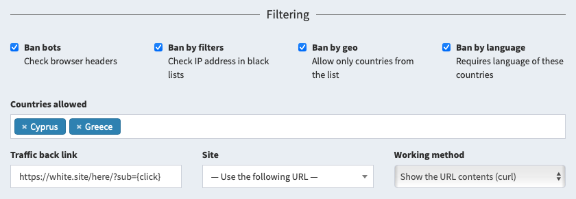
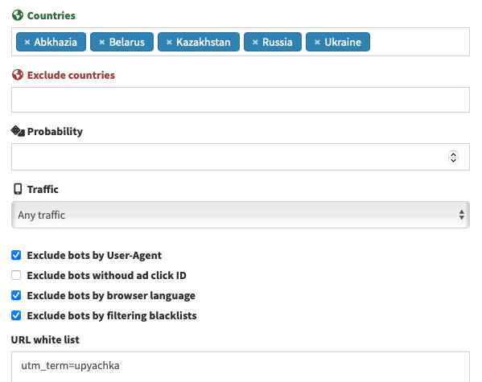

# Traffic filtering

The tracker has built-in traffic filtering tools. They allow you to block bots and spammers on various AlterCPA Lite blacklists.

## Filter settings

The flow can be connected to an existing traffic filtering campaign. The flow will use all the settings of geography, languages, special filters, operating systems, browsers, protocols, black and white lists. At the same time, the settings of the target and dummy site, their methods of operation and the filter activity itself are ignored. Data on the verification of each visit is saved in the campaign click log.

You can also set up simple filtering manually. Manual filters are configured inside the flow in the "Filtering" section. The following global settings are available to you:

- **Bots**: blocking is based on well-known browser headers used by various bots, including spyware and crawlers.
- **Black lists**: the visitor's main IP address is checked against smart blacklists.
- **Country**: visits that are not included in the list of allowed countries are blocked.
- **Language**: visits that do not support at least one of the languages of the allowed countries are blocked.
- **Ad ID**: blocks visit if it has no click ID of popular ad networks such as Google, Facebook or Bing.
- **Coutries allowed**: list of countries from which visitors and languages are allowed.

If a visit is blocked by manual filters or filtering campaign, a trafficback is shown to the user. This is analogous to a dummy site in a filtering campaign. The following settings are available:

- **Site.** One of the sites located in [your repository](sites.md). If selected, the link and working method are ignored.
- **Trafficback link.** URL or path to a file that is shown when a visit is blocked. If no link or site is provided, a random HTTP error is shown to the user.
- **Working method.** One of the options for displaying trafficback is similarly described in the section "[Working methods](method.md)".

When each filter is triggered, its type will be recorded in the filtering log: bots, geo, language, or blacklist. You can view the data on the triggering of filters in the "[Statistics](/track-stats?item=filter)" section with the "Filter" criterion selected.

> There is a belief that the headers and cookies that the tracker sends can affect the quality of filtering. To ensure that your advertising campaign is not banned, you can activate the “Do not send additional headers and cookies to visitors” mode. Of the minuses: this function also disables checking the uniqueness of clicks and breaks the way rotation mechanism. In most cases this is not critical. You can also prohibit sending headers only for trafficback.

## Filters in ways

Additional traffic filters are embedded inside each way:

- **Allowed and prohibited countries.** Makes not only allowing, but also excluding countries possible. Useful for creating ways that serve all but the selected countries.
- **Probability.** Doesn't prohibit passing along the way, but allows you to reduce or increase the number of visitors.
- **Traffic.** Determines which devices can open this way: desktop, mobile, iOS/Android.
- **Exclude bots by User-Agent, language, and filtering greylists.** Works the same way as global bot blocking.
- **Exclude bots without an ad click ID.** Checks for common ad parameters and blocks traffic that bypasses the ad.
- **White and black list of URLs.** Allows you to specify arbitrary words that should or should not be present in the link. Set one word per line.

If none of the ways fit the visitor, he will be directed to trafficback. This event will be recorded as "Trafficback" in the filtering log.
