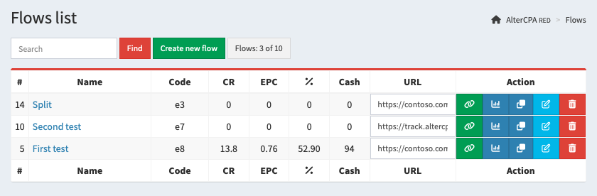
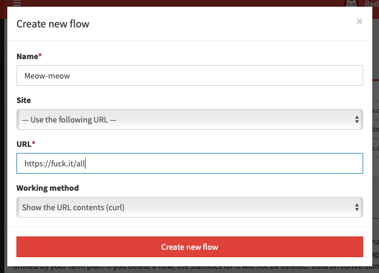
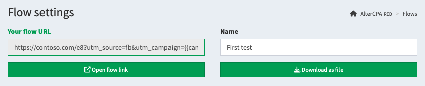

# Flows and traffic

Flows are the backbone of the tracker. We pass all traffic through flows. The number of available flows is not limited at all. The amount of traffic is only limited by the power of your main server.

## Creating a flow

Working with flows is done in the "[Flows](/track-flows)" section of the tracker.

It presents a table with created flows, which indicates:

- **Flow name**: used for convenience.
- **Flow character code:** is used in links and [API](api.md), never changes.
- **Conversion, EPC, and approval**: live traffic metrics for the last three days.
- **Amount**: the total earnings for the flow for the entire time of its operation.
- **URL** and **Copy**: flow link for traffic based on the domain and a button to open the link in a new window or copy it to clipboard.
- **Statistics**: a summary table of indicators for the selected flow.
- **Clone**: creates a new flow with the same way composition and settings.
- **Settings**: opens the flow and ways creation page.
- **Deletion**: completely deletes the flow and cannot be recovered. At the same time, statistics do not disappear from the database.

To add a flow, click on "Create new flow" above the table. You need to enter its name and set up the first way that traffic will go to. The way can be [site](sites.md) or a link with the selected [working method](method.md).

After creating a flow, you will be redirected to its settings page. Here you can add new ways, configure [traffic filters](filter.md), setup [integration](postback.md) with affiliate network, add [postbacks and tags](tags.md).

> You can create a flow in a simplified mode, without split testing mode. In this configuration, you will only have access to one way in the flow without any additional settings. This is convenient for beginners. You can switch the flow to full mode at any time with a single button.

## Ways in the flow

A flow consists of one or [several ways](split.md). The first way is added automatically when the flow is created. To change its link, site or method of operation, click on the edit button in the list of ways.

To add a way in the flow, click on "Create new way" below the table. You will need to provide a title, select [site from the repository](sites.md) or provide a link and its [working method](method.md).

The following settings are available for the way:

- **Name** - used for easy search. The first way has the same name as the flow.
- **Site** - the [site from the repository](sites.md) attached to this way. One site can be linked to any number of ways, including within one flow.
- **URL** - if no site is selected, the link or file path is used.
- **Working method** - one of the [available methods](method.md) that is used to work with the link.
- **Countries** - list of geos for which this way is shown. Allows you to create different ways for each geo.
- **Exclude countries** - list of geos for which this way is hidden. Useful for creating a fallback way.
- **Probability** - chance of showing exactly this way. Specified as a percentage from 1 to 100. If the total sum of all probabilities is greater than one hundred percent, the odds are normalized to one hundred. If less than 100% - the remainder is divided between the ways without specifying the probability.
- **Traffic** - devices for which this way will be displayed: desktop or mobile.
- **Exclude bots by criteria** - [traffic filtering](filter.md) settings for the selected way.
- **URL blacklist and whitelist** - filters by the presence or absence of keywords in the link.
- **Activity checkbox** - if it is absent, no traffic is received on this way.

You can also configure the "next step" of the path. If you are working with a prelanding-landing link, your prelanding will be the main step of the path, and the landing page will be the next one. Don’t forget to get the next step link on the prelanding page via the `{next}` macro in the link or site code. The parameters of the next step are similar to the main:

- **Next step site** - the [site from the repository](sites.md) attached to this way.
- **Next step URL** - if no site is selected, the link or file path is used.
- **Working method** - one of the [available methods](method.md) that is used to work with the link.

Below the table with the list of ways are [way rotation settings](split.md). You can choose an algorithm by which the tracker will choose the best way for the visitor using the "multi-armed bandits" method. By default, the selected way is assigned to the client, but you can activate the rotation and show the client a new way each visit.

[Learn more about ways and split tests](split.md)

## Link and local file

There are two main methods for using a flow: working with a link and working with a local file.

Both a local file, a link through the main server, and a link through the site store work the same way and use the same implementation mechanism. You can use any option you like with the same result.

- **When running from a link**, you are using a flow link to fill traffic. It can use any of the [domains](domain.md) you parked. Links can be pasted to the main page of the domain. The central server or your [site repository](sites.md).
- **When working with a local file**, you download the client file and place it on your server or regular hosting. The tracker itself is responsible for the analytics of visits, the file on the server is responsible for downloading content and displaying content. A very convenient option for distributing responsibility to different servers.

## Domains and glue

When using a link, it is not recommended to use the system domain - it may be blacklisted by advertising networks. Be sure to [park your own domains](domain.md) to send traffic.

Select a parked domain in the flow settings and the link will be changed to the new domain. You can also bind a domain to a flow. This will open the flow on the main page of the domain without specifying additional characters in the way.

[Learn more about domain parking](domain.md)

## Traffic filtering

You can enable [traffic filters](filter.md) in the flow and send unwanted visits to trafficback.

Available filtering options:

- **Block bots by browser, geo, language and blacklist** - enables blocking mechanisms.
- **List of countries** - determines the geos for which the real site is shown.
- **Site** - one of the sites loaded into the repository to use as a stub.
- **Trafficback** - stub link if no site is specified.
- **Working method** - link implementation option, if the site is not specified.

[Learn more about traffic filters](filter.md)

## Integration with affiliate networks

The main task of the tracker is receiving notifications about successful actions in target networks. To do this, you need to set up links and sites to pass the click ID, and [postback](postback.md) to the target affiliate network.

Select the affiliate network you need in the "Integration" section and check the "Automatically add click ID to link" checkbox. Copy the received [postbacks](postback.md) and install them in the affiliate network.

If your network doesn't support server postbacks, you can enable tracking [using pixels](pixel.md). To do this, check the "Allow tracking via pixels" box and copy the pixel code to your network.

[Learn more about incoming postbacks](postback.md)

## Postbacks and tags

In the flow settings, you can specify tags and macros to track traffic. The following parameters are available to you, which are collected in statistics:

- Tag **SubID** and its parameter `subid`.
- Tag **UTM Source** and its parameter `utm_source`.
- Tag **UTM Campaign** and its parameter `utm_campaign`.
- Tag **UTM Content** and its parameter `utm_content`.
- Tag **UTM Term** and its parameter `utm_term`.
- Tag **UTM Medium** and its parameter `utm_medium`.
- The click price in the `cpc` parameter and its currency in the `currency` parameter.

Statistics are generated only for these six tags. Other parameters and tags are ignored when recording a visit and do not participate in the creation of statistics. It makes no sense to use some `sub1` or `s2`, we will ignore them.

You can also use additional parameters that are not used in statistics, but can be used in postbacks, for example, to optimize mobile applications or ad networks:

- Ad click ID from parameters: `fbclid`, `gclid`, `adclid`, `clid`, `adid`.
- Custom data #1 from parameters `data1` or `d1`.
- Custom data #2 from parameters `data2` or `d2`.
- Custom data #3 from parameters `data3` or `d3`.
- Custom data #4 from parameters `data4` or `d4`.
- Custom data #5 from parameters `data5` or `d5`.

Tags can be used in postbacks for integration with ad networks. You can set postbacks in the flow settings for the following events:

- **Global postback**: fires on any lead change.
- **New lead**: fires only when a lead is created, in any status.
- **Lead moved to hold, approve, cancel and trash status**: fires when the status of an existing lead changes.

You can also use hidden data. This data isn't displayed in the link and can only be used for embedding on websites or in links. It's convenient for passing parameters that shouldn't be shown to the user in the link but should be used within the website. For example, analytics system identifiers or links to showcase pages.

[Learn more about outgoing postbacks](tags.md)

## Macros in the link

In the URL field in ways and trafficback, you can use macros. They will be replaced by the corresponding parameters at the time of transition.

- `{click}` - character identifier of the click.
- `{flow}` - character identifier of the flow.
- `{user}` - user ID.
- `{geo}` - ISO code of the country of the click.
- `{query}` - the line of GET-parameters.
- `{next}` - the link to the second step of the flow.
- `{utm_source}` - UTM Source tag.
- `{utm_campaign}` - UTM Campaign tag.
- `{utm_content}` - UTM Content tag.
- `{utm_term}` - UTM Term tag.
- `{utm_medium}` - UTM Medium tag.
- `{host}` - domain.
- `{subid}` - SubID tag.
- `{customer}` - Customer tag.
- `{adid}` - click ID in the ad network.
- `{data1}` - custom data field 1.
- `{data2}` - custom data field 2.
- `{data3}` - custom data field 3.
- `{data4}` - custom data field 4.
- `{data5}` - custom data field 5.
- `{esub}` - encrypted SubID tag.
- `{eutms}` - encrypted UTM Source tag.
- `{eutmc}` - encrypted UTM Campaign tag.
- `{eutmn}` - encrypted UTM Content tag.
- `{eutmt}` - encrypted UTM Term tag.
- `{eutmm}` - encrypted UTM Medium tag.
- `{eutmu}` - encrypted Customer tag.
- `{ed1}` - encrypted custom data field 1.
- `{ed2}` - encrypted custom data field 2.
- `{ed3}` - encrypted custom data field 3.
- `{ed4}` - encrypted custom data field 4.
- `{ed5}` - encrypted custom data field 5.
- `{hide1}` - hidden flow or way data field 1.
- `{hide2}` - hidden flow or way data field 2.
- `{hide3}` - hidden flow or way data field 3.
- `{hide4}` - hidden flow or way data field 4.
- `{hide5}` - hidden flow or way data field 5.
- `{hide6}` - hidden flow or way data field 6.

> **Lifehack:** when working with local files, you can use the `{geo}` parameter in the link to open different files depending on the visitor's country, for example: `pages/{geo}.html`.
