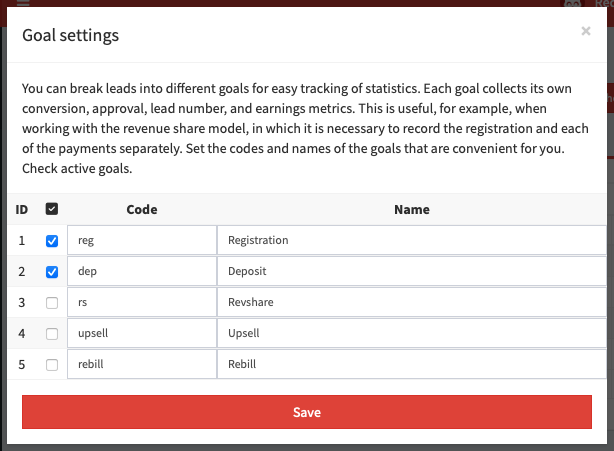
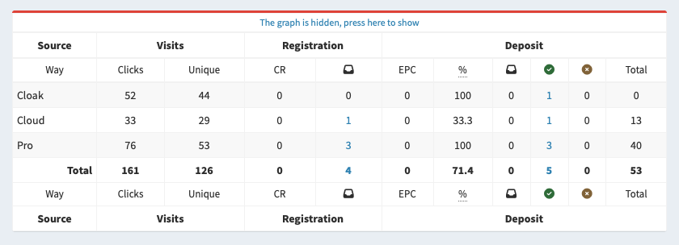

# Goals

In addition to the main statuses, you can further break down leads into five different goals. This is useful when working with offers in which several leads can be created with one click. For example, in the RevShare model, you need to separately collect registrations and each of the payments.

## Setting up goals

Goals can be configured in the "[Statistics](/track-stats)" and "[Leads](/track-leads)" sections. Go to one of these sections and click on the "Goal" button above the table.

A pop-up window with goal settings will open:

- **Activity checkbox**: enables the corresponding goal.
- **Code**: specifies the character code to use in the `goal` parameter of the postback.
- **Title**: used in reports to visually identify the goal.

You can use up to five different goals at the same time, plus have leads without a goal. After activating the goals, you can set up a special kind of statistics section.

## Statistics by goals

In the [statistics](/track-stats) section, you can enable additional columns for each of the goals: conversion rates, EPC, approval, number of leads by status, financial data. When downloading a report in Excel, it always contains all the columns of statistics by goals.

The following fields are used in the goal statistics:

- The hit percentage of the goal, calculated by the total number of leads.
- CR: conversion percentage from unique clicks to valid leads.
- EPC: the ratio of earnings to unique clicks.
- EPL: the ratio of earnings to approved and holded leads.
- Approve: the ratio of confirmed leads to valid leads.
- Approve with trash: the ratio of confirmed leads to the total number of leads.
- Total number of leads received.
- Valid leads: the number of incoming leads excluding trash.
- Number of leads by status: new, hold, approve, cancel and trash.
- Finance: total payout amount for leads in hold and approve statuses, separate amounts for these statuses.

> **Example**: when working with the gambling and betting verticals, you may need a special column setup. Disable all checkboxes for conversions, leads, and finances without reference to goals. Create two goals - registration and deposit. For the "Registration" goal, enable conversion and total leads. For the "Deposit" goal, enable EPC, approve, the number of leads in the "Hold", "Approve" and "Trash" statuses, as well as financial indicators.

## Postback features

When using goals, it's important to remember that different goals don't create a new lead for the same click. To create new leads, add a unique parameter `uid` to the postback.

> **Example 1**: when working with registrations and payments, you need to create separate leads for registration and deposit. For registration you can use `uid=reg`, for deposit `uid=dep` or a specific payment ID.

When working with SOI goals, do not forget to add `status=approve` to the postback, otherwise leads will be created in the "New" status and finances for them wont be summed up.

> **Example 2**: when working with buyout and return, you do not need to create a new lead at the time of order payment. It is enough to use `uid` with the value of the order ID on the side of the affiliate network, and the lead will simply change its goal to "Buyout".
