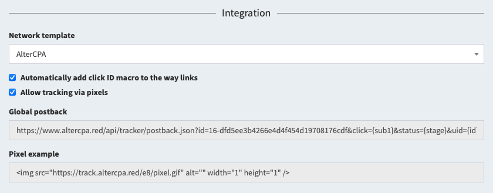

# Postbacks and integration

Traffic tracking is processes using postback requests. The postback can create a lead by click ID or flow ID. If you need postback-free integration, check out the [tracking via pixels](pixel.md) guide.

## Integration

The tracker contains ready-made templates for integration with popular affiliate networks and platforms. In the flow settings, go to the "Integration" section and select the network you are interested in.



In the integration settings, check the box "**Automatically add click ID to link**" and all links in flows will be adjusted to the selected network. You can set up the links manually by specifying the `{click}` macro for our click ID in them. When working with [local sites](sites.md), add a field with this macro to the form - it will be substituted automatically.

```html
<input type="hidden" name="subid" value="{click}" />
```

After selecting a network, sample postbacks will be shown in the integration block. Put them in the network settings in the appropriate fields, for example, in the global postback or postbacks for deposit and registration.

## Manual postback settings

You can compose a postback request yourself. A sample postback with your code and parameters for the click ID is shown in the integration section.

```
https://domain.com/postbacks/TOKEN?click={click}
```

Available query options:

- `click` - click ID from our tracker.
- `uid` - unique lead ID on the affiliate network side.
- `status` - lead status: `new`, `hold`, `approve`, `cancel` , `trash`.
- `goal` - character [goal identifier](goal.md).
- `price` - payout amount per lead.
- `currency` - three-letter ISO code of the currency in which the payment is made.
- `create=1` - create new lead on every postback received.
- `name`, `phone`, `email`, `comment`, `geo`, `ip` - lead data.
- `utm_source`, `utm_campaign`, `utm_content`, `utm_term`, `utm_medium`, `subid`, `domain`, `adid`, `data1`, `data2` - lead tags that replace those received from click.

For a complete list of parameters and possible response formats, see [API manual about the postback function](api-tracker.md#postback).

## Working with custom statuses

The tracker can recognize statuses automatically and adapts to most affiliate networks. But sometimes it's useful to specify which statuses to consider as a new order, which ones to consider as approved, what to send to trash.

The following parameters are used to specify special statuses:

- `stn` - list of new lead statuses.
- `sth` - list of statuses that fall into the hold.
- `sta` - list of statuses that are recognized as an approve.
- `stc` - list of valid cancellation statuses.
- `stt` - list of trash statuses.

Each parameter can contain either one status or several statuses separated by commas. Statuses are case-insensitive and special characters are ignored - you don't need to care of them.

> **Important!** The `hold` status in our tracker **is not a pending status**. This is a delayed confirmation - leads that are confirmed but not yet paid. It is involved in the calculation of approval and EPC. Don't use it as pending status.

For example, when working with the KMA network, the following statuses are used: `A` - approve, `D` - cancel, `F` - trash, `P ` - new order. The parameters will look like this:

```
stn=P&sta=A&stc=D&stt=F
```

## Working with customer data

The tracker allows you to collect and store the data of buyers that they enter on the sites. You can remove the postback for a new lead from the affiliate network and instead send a new lead to the tracker from the thank you page.

The following fields are available to you:

- `name` - the customer's full name.
- `phone` - customer's phone number (saved without correction and validation).
- `email` - customer's mail (saved without correction and validation).
- `comment` - custom comment to the lead.
- `meta[xxx]` - custom field with the name `xxx` (not exported to Excel, available only in extended info and API).

> **Lifehack**: you can send leads to the affiliate network using the lead creation postback in the flow settings. Read more about this form of perversion [here](tags.md#send).

## Working without click ID

Working with leads can be done in two ways - by click ID or by flow ID. The second option can be useful in situations where there is no concept of following a link, for example, when working with applications.

When working with a click ID, you need to specify it in the `click` parameter. When working with a flow ID, you need to specify the parameters `flow` with a character flow ID and `subid` with a unique lead ID.

The use of `subid` is strictly required. It is `subid` that is used to identify unique leads. It is recommended to send data about geo, IP-address and tags in postback.

## Postbacks log

All postbacks that arrive in the tracker by your leads are saved in the “Incoming postbacks” subsection of the “Logs” section. The following information about postbacks is available to you:

- **Time of receiving postback** - you can search for postbacks by the date range when they were received.
- **Flow**, **click**, **lead** and **site** - identifiers from the lead for which the postback was sent. You can filter postbacks by a specific ID.
- **Status**, which was specified for the lead after processing the postback. Even if the status did not change by the request.
- **Error** - result of postback processing:
  - `access` - access to the click or flow with this identifier is prohibited.
  - `bad-click` - incorrect click ID was sent.
  - `bad-flow` - incorrect flow ID was sent.
  - `db` - a database error occurred during processing.
  - `no-changes` - no changes were required (possibly not an error).
  - `no-click` - neither click ID nor flow ID were sent.

You can view detailed information about the request if you click on “Show” in the “Info” column:

- **URL** - the full link used to make the request.
- **GET** - decryption of data from the GET part of the request. Always shown in JSON representation.
- **POST** - data in the POST block that was sent to the server. JSON is always used to display data because it looks nice.
- **Server response** - data sent by the server in response to the request.
- **IP**, **browser** and **User-Agent** - information about the server that made the request.
