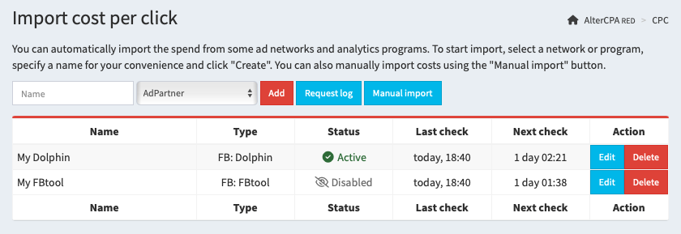

# Spend analytics

The tracker allows you to track your advertising costs and analyze the ROI of your advertising campaigns. Information about the cost of a click can be obtained via a link, uploaded via the API, or downloaded directly from third-party analytics services.

## Working methods

You can use four methods to import expenses into the tracker:

- [Automatic import](#auto) allows you to set up a connection to advertising networks and analytics systems, and load cost data on a schedule through their API.
- [Adding via link](#link) is convenient for teaser networks that can transfer the cost of a click directly in the link to which the visitor is directed.
- [Manual loading](#manual) is useful for testing the ROI calculation mechanisms themselves or for working with networks in which CPC downloading is not available in principle.
- [Working via API](#api) is an automated implementation of manual loading with which you can unload data from services, for example, through postback requests.

You can use all these methods simultaneously for different sources. But be sure to set up the stream links yourself.

[Show some examples](#example)



> **Extremely important!** Expense loading will not work on its own, it requires special link setup. You must send the identifier of the creative, ad or ad set for which you will load statistics in the future to one of the UTM tags. Otherwise, we simply will not be able to match your clicks with financial loads.

<a id="auto"></a>

## Automatic import

Connecting services for automatic import is done in the "[Expenses](/track-spend) section. To add a new loader, enter a name and select a service from the drop-down list. The number of services for downloading is not limited.

All methods for loading expenses have some common settings that are the same for all services:

- **Spemd downloading is enabled** - activates the download schedule.
- **Name** - used for ease of search.
- **Access settings** - API keys, logins and passwords that are necessary for downloading to work are different for each service.
- **Check schedule** - from hourly to check every three days. The general recommendation is to check twice a day.
- **Upload period** - the time for which data is retrieved. The best option is to upload for yesterday and today.
- **Filter by source** - will apply price tags only to the selected `utm_source`, which is convenient for separating traffic sources.
- **Binding a tag to a parameter** - allows you to specify which UTM tag you are sending the desired parameter to and what parameter it is. For example, this could be the ad ID in the `utm_content` tag.

As usual, all the loaders are configured in the same way:

1. Create a loader of the advertising network you need.
2. Specify the API key of this network.
3. Select to downpload twice a day for yesterday and today.
4. Specify the `utm_source` label with which you are loading from this source.
5. Specify `utm_content` as the main tag and send your creative ID to it.

These general guidelines will work for most networks.

<a id="link"></a>

## Adding via link

When working with teaser networks, you can pass the click price directly in the query string. To do this, use two parameters:

- `cpc` - click price in the currency of your choice with an accuracy of 6 characters.
- `cur` - click price currency, `usd` is used by default.

It is recommended to use this approach when working with redirects. In other cases, the user may accidentally refresh the page and thereby add an additional price tag to the click.

<a id="manual"></a>

## Manual loading

You can enter spend for a period manually. To do this, in the "[Spend](/track-spend)" section, go to the "[Manual import](/track-spend/manual)" tab and fill out the form.

Indicate spends using one of the methods - total amount or price per click.

- **Total spend** - the amount you spent on all clicks. In this case, each click will be assigned an amount evenly.
- **Click price** - the same amount per click.
- **Currency** - USD is used by default, but you can specify price tags in any currency, they will be recalculated automatically when viewing statistics.

Specify the criteria by which the price tag is assigned. At least one criterion is required:

- **Date from-to** - the range of dates for which the click price is indicated.
- **Flow** and **geo** that received clicks.
- **UTM tags**, **domain** and **SubID** - tags by which you can filter clicks and add data for specific ads and campaigns. li>
			**Only valid clicks** - when working with traffic filters, the cost of the click will be recorded in clicks that were not sent to trafficback.
**Only unique clicks** - repeated visits will not receive their price tag.

<a id="api"></a>

## Working via API

APIs implement the same mechanism as manual import of click prices. You can load total price or one-click price with filtering by dates, flows, ways and tags. Full documentation is available in the [API](api-tracker.md#spend) section.

[API manual](api-tracker.md#spend)

<a id="example"></a>

## Setup recommendations

In this section, we have collected recommendations for connecting to various advertising sources. For Facebook use [Dolphin](#dolphin) or [FBtool](#fbtool).

<a id="adpartner"></a>

### AdPartner

- **Working method**: automated download.
- **Recommended check term**: yesterday and today.
- **Recommended check period**: three times a day.

To integrate with AdPartner, provide your API key.

<a id="directadvert"></a>

### DirectAdvert

- **Working method**: transferring the click price in the link.
- **Link tail**: `&cpc={CLICK_PRICE}`

Your link will look somehow like this:

```
https://track.altercpa.one/face?utm_source=directadvert&utm_medium={SRC_ID}&utm_content={AD_ID}&cpc={CLICK_PRICE}
```

<a id="dolphincl"></a>

### Facebook via Dolphin Cloud

- **Working method**: automated download.
- **Recommended check term**: yesterday and today.
- **Recommended check period**: three times a day.

To integrate with Dolphin, specify the token. The token can be taken on the page [https://cloud.dolphin.tech/app/fb/settings](https://cloud.dolphin.tech/app/fb/settings), in the "Authorization token for integrations" field.

To download statistics, use `utm_content`, which should be specified like this:

- **Download by camgaign ID**: `utm_content={{campaign.id}}`
- **Download by ad set ID**: `utm_content={{adset.id}}`
- **Download by ad ID**: `utm_content={{ad.id}}`

<a id="dolphin"></a>

### Facebook via server-based Dolphin

- **Working method**: automated download.
- **Recommended check term**: yesterday and today.
- **Recommended check period**: three times a day.

To integrate with Dolphin, provide the URL where it is installed in the format `http://site.com/`. To receive a token, use **[official instructions](https://documenter.getpostman.com/view/15402503/TzJrBJdk)**. Do not use an administrator token; it will not allow you to download statistics for other users. Each Dolphin user must add the loader themselves.

To download statistics, use `utm_content`, which should be specified like this:

- **Download by camgaign ID**: `utm_content={{campaign.id}}`
- **Download by ad set ID**: `utm_content={{adset.id}}`
- **Download by ad ID**: `utm_content={{ad.id}}`

<a id="fbtool"></a>

### Facebook via FBtool

- **Working method**: automated download.
- **Recommended check term**: yesterday and today.
- **Recommended check period**: twice a day.

To integrate with FBtool, provide your API key. You can specify a list of account IDs for which you want to display statistics. Accounts are indicated separated by commas. If accounts are not specified, statistics are downloaded for all accounts.

To download statistics, use `utm_content`, which should be specified like this:

- **Download by camgaign ID**: `utm_content={{campaign.id}}`
- **Download by ad set ID**: `utm_content={{adset.id}}`
- **Download by ad ID**: `utm_content={{ad.id}}`

<a id="facebook"></a>

### Facebook directly

- **Working method**: automated download.
- **Recommended check term**: yesterday and today.
- **Recommended check period**: twice a day.

To integrate with Facebook directly, provide your API token. Register on developers.facebook.com, create an application like Other - Business. After creation, go to the Marketing API, in the Tools section, check all the boxes and click Get Token. It is recommended to specify a proxy for downloading data.

To download statistics, use `utm_content`, which should be specified like this:

- **Download by camgaign ID**: `utm_content={{campaign.id}}`
- **Download by ad set ID**: `utm_content={{adset.id}}`
- **Download by ad ID**: `utm_content={{ad.id}}`

<a id="mgid"></a>

### MGid

- **Working method**: automated download.
- **Recommended check term**: yesterday and today.
- **Recommended check period**: twice a day.

To integrate with MGid, enter your username (email) and password. In the UTM tag field, select which tag you are passing the advertising campaign ID to.

<a id="mixadvert"></a>

### MixAdvert

- **Working method**: automated download.
- **Recommended check term**: yesterday and today.
- **Recommended check period**: three times a day.

To integrate with MixAdvert, enter your login and token from the API section.
