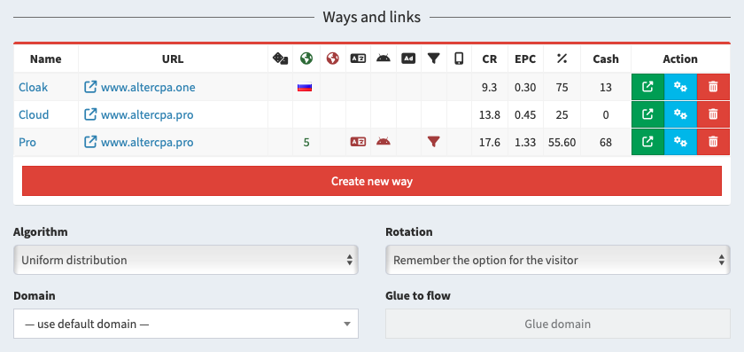

# Split testing

Flows allow you to perform smart split testing and create smart links. Views can be optimized using the multi-armed bandit algorithm. Split testing is built into any flow.

[Watch the video on YouTube](https://www.youtube.com/watch?v=-NE4qJsGwc4)

## Multiple ways

Each flow can consist of multiple ways. The number of ways per flow is unlimited.

The first way is always automatically created when a flow is added. To add a way in a flow, open its settings and click "Create new way". You need to enter a title and select [site](sites.md) or enter a link with [work method](method.md). Ways within a flow can work simultaneously with different link settings and work methods.

The following content display settings are available for the way:

- **Name** - used for easy search. The first way has the same name as the flow.
- **Site** - attached to the [site from the repository](sites.md) way. One site can be linked to any number of ways, including within one flow.
- **URL** - if no site is selected, a link or file path is used.
- **Working method** - one of the [available methods](method.md) that is used to work with the link.

Each way can specify its own individual filtering settings. If you need identical filtering principles for all ways, simply specify them in the flow itself, leaving the way settings empty. The following filters are available:

- **Exclude bots by criteria** - [traffic filtering](filter.md) settings for the selected way.
- **Countries** - list of geos for which this way is shown. Allows you to create different ways for each geo.
- **Exclude countries** - list of geos for which this way is hidden. Useful for creating a fallback way.
- **Probability** - chance of showing exactly this way. Specified as a percentage from 1 to 100. If the total sum of all probabilities is greater than one hundred percent, the odds are normalized to one hundred. If less than 100% - the remainder is divided between the ways without specifying the probability.
- **Traffic** - devices for which this way will be displayed: desktop or mobile.
- **URL blacklist and whitelist** - filters by the presence or absence of keywords in the link.

You can also configure the "next step" of the path. If you are working with a prelanding-landing link, your prelanding will be the main step of the path, and the landing page will be the next one. Don’t forget to get the next step link on the prelanding page via the `{next}` macro in the link or site code. The parameters of the next step are similar to the main:

- **Next step site** - the [site from the repository](sites.md) attached to this way.
- **Next step URL** - if no site is selected, the link or file path is used.
- **Working method** - one of the [available methods](method.md) that is used to work with the link.

When choosing a way, the tracker analyzes all options available for the selected filters and distributes visits between them. If ways do not have probabilities specified, traffic is distributed evenly. Traffic is distributed only between active ways. You can deactivate a way by pressing the "Pause" button in the list.

## Caps and limits

You can limit the visitors coming to each way using caps and work schedules. Caps set the maximum number of leads that the way is ready to accept in the selected period. Available settings:

- **Cap**: the period for which the calculation is carried out.
  - **Cap disabled** - the number of leads is not limited.
  - **24 hours** - we count leads for 24 hours from the current moment.
  - **Starting from midnight** - we count leads for the current calendar day.
  - **Week** - we count leads for 7 days from the current moment (not from midnight).
  - **Month** - we count leads for 30 days from the current moment.
  - **Year** - we count leads for 356 days from the current moment.
  - **For any time** - we count all leads for the entire life of the way.
  - **During working hours** - we count only leads for the previous period of working hours.
- **Status**: leads are counted only in selected statuses.
  - **Any leads** - statuses are not taken into account when calculating.
  - **Only valid leads** - statuses "New", "Hold", "Approve" and "Cancel".
  - **Pending leads** - only status "New".
  - **Confirmed leads** - only status "Approve".
  - **Approved and hold** - statuses "Hold" and "Approve".
  - **Any leads except cancelled** - statuses "New", "Hold" and "Approve".
- **Limit**: the number of leads of the selected status for the selected period that is allowed for this way.

The limit does not guarantee perfect accuracy in the number of leads. If a visitor has followed the way and left a lead a few minutes later, a new visitor may arrive in these few minutes and end up on the same way, also sending a new lead.

You can also set the schedule for the way itself, for example, depending on the availability of your call center:

- **Days of the week**: you can specify specific days on which the way will be active.
- **Schedule**: the start and end time of the path activity are specified, hours and minutes separately.
- **Time zone**: replaces the system time zone for calculating the schedule and days of the week.

When combining days of the week and schedules by time, we take into account the start of the working period. For example, if you select Friday from 23:00 to 02:00, the way will activate at 23:00 on Friday and will run until 02:00 on Saturday.

## Optimization algorithms

With an even distribution of traffic, there is a chance to lose a large number of visits on unsuccessful options. To avoid these troubles, you can enable a smart distribution algorithm using the multi-armed bandit method. To do this, in the flow settings, immediately below the list of ways, select a special algorithm instead of "Uniform distribution".

Several optimization algorithms are available to you:

- **Priority of conversion**: considers the ratio of valid leads to unique clicks.
- **Priority of conversion and approve**: considers the ratio of approved leads to unique clicks.
- **Priority of EPC**: considers the ratio of earnings from approved leads to the number of unique clicks.
- **Priority of approve**: considers the ratio of the number of approved leads to the number of valid leads.
- **Priority of profit**: considers the total amount of earnings on the selected way over time.
- **Priority of conversion by geo**: calculates the conversion priority separately for each geo.
- **Priority of EPC by geo**: calculates the EPC priority separately for each geo.

The figures are calculated for the last three days and are updated every ten minutes when there is traffic.

Please note that the multi-armed bandit algorithm only gives more traffic to some ways, and does not transfer traffic to them entirely - it is spread between all ways with the specified priority. You can separate some traffic and always send it only to the best way. To do this, use the "**Best option**" parameter and the percentage of traffic that will always go to the best option. The optimal value is 50% of traffic.

By default, the selected option is assigned to the visitor. You can further increase the reach of options and show a new available option each time a visitor opens the link. This is especially useful when creating smartlinks in the dating vertical.

There's a special form of click distribution without optimization — stupid uniform distribution. This approach routes clicks alternately to each available way, ignoring their probabilities, and almost perfectly distributes an equal number of clicks to each way. It only works in split tests without additional filters on the ways. Even this approach can sometimes result in slightly more clicks on one of the ways.

## Success analysis

Way settings immediately show their current success rate. Conversion, EPC and approve are calculated for the last three days starting at midnight. The amount of earnings is calculated for the entire time. Indicators are recalculated every 10 minutes when there is traffic.

These indicators are enough to preliminarily evaluate which of the test options works better. But for a deeper analysis, it is recommended to compare data for an arbitrary period and check the number of leads and clicks for each of the ways.

1. Go to "[Flows](/track-flows)" and find the flow you need.
2. Click on the "[Statistics](/track-stats)" button of the selected flow.
3. In the first filter drop-down list, select grouping by the "Way" field.
4. Specify a convenient date range for analysis and compare the success of each of the options across all available parameters.

You can optionally use [advanced filters](stats.md) to view statistics for specific geos, devices, and tags.
