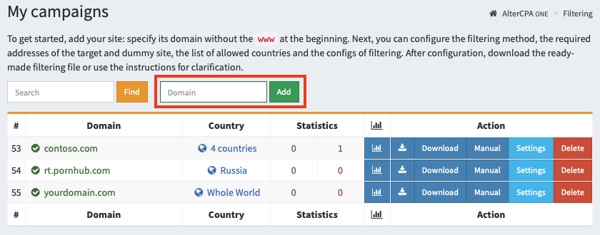
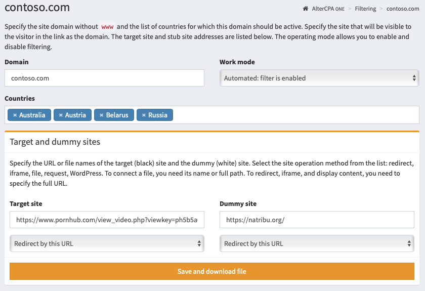

# Working with sites

::: card
### Section summary

1. Go to "[My campaigns](/filter)", enter the domain in the green field "Domain", click **Add**.
2. Select the countries from which you expect visits.
3. Please include the filenames or full URLs of your target and dummy sites.
4. Choose a working method: redirect, file connection, iframe, CURL request, WordPress.
5. Click **"Save and download file"** and host the file.

[Everything is clear, let's get to work!](/filter)
:::

## Adding a campaign

Start your work by adding a campaign. Campaigns are your filtering settings for traffic. Working with campaigns is carried out in the section "[My campaigns](/filter)".

To create a campaign, specify its domain or name and click "Add". When using the the domain, it is specified without `www` at the beginning.

After adding a campaign, you need to configure the basic traffic filtering parameters:

- **Domain**. This domain will host your traffic filtering file. Instead of a domain, you can specify the name of the campaign, but in this case, do not uncheck the "Ignore domain" box in the advanced settings.
- **Work mode**. Use "Automated" for real tasks and "Pause" for testing.
- **Countries list**. We recommend that you provide a list of countries from which you expect visitors.
- **Target and dummy sites**. Specify the files or URLs of the respective sites and their mode of operation. Read more about it [here](code.md).

Click "Save and download file", place the resulting file on your hosting for the selected domain.

> **Important!** If you change the way the dummy or target site works, you need to re-download the new filter file! If you change other settings, such as links or filters, you do not need to download a new file.

## Site settings

You can specify additional site settings that may not match our vision of perfectly simple filtering.

### Main parameters

- **Domain** - will be used to install the traffic filter itself in one of the convenient ways. Please note that this is not the domain of your target site, because the filter will most likely be placed on a completely different domain. ***Interesting fact**: actually, the "domain" field can be anything. In reality, it is used only to check the headers (host or referrer) of incoming traffic. But you can check the "Ignore domain" checkbox in the site settings and specify any text.*
- **Work mode** determines whether filtering is enabled.
				
				Automatic mode turns on the filter. A pause always shows a dummy site. A disabled filter always shows the target site.
  - **Auto mode**: the filter is enabled and checks the traffic.
  - **Pause**: always shows the dummy site, visit data is not saved.
  - **Disabled**: always shows the target site, visit data is not saved.
  - **Training with dummy**: always shows the dummy site, but logs the visits and real filter responses.
  - **Training with target**: always shows the target site with saved visit data.
- **Countries** - you can limit the list of countries from which visits will go to the target site. If no country is selected, then traffic will come regardless of its geography. We strongly recommend specifying a limited list of countries to filter out visits from bots located on remote servers.
- **Target and dummy sites** - in these fields you need to specify the URL or file name (only when working with a file include). [Read more about target and dummy sites](code.md).
- **Site working method** - choose a display method for the target and dummy sites. Depending on the chosen methods, we will create a ready-made filtering file. **After changing the method you must download new filtering file!** [Read more about the methods](code.md).

### Extra options

- **Trash visits** - the filter will discard the number of visits specified in this field and show them the dummy site. Useful when testing a filter. With each call, the number in this field will decrease.
- **IP protocol version** - you can only admit visitors to your site who are accessing IPv4 or IPv6. Useful for organizing IPv6 honeypots.
- **Traffic** - you can limit the list of devices from which traffic will come. There is a choice of desktop traffic and mobile traffic (any, iOS and non-iOS)
- **Operating systems** - list of OS from which traffic is allowed. If the OS is not recognized, it is always blocked.
- **Browsers** - list of browsers from which traffic is allowed. If the browser is not recognized, it is always blocked.
- **Ignore request domain** - may come in handy if you use the same site to work with multiple domains or via API without taking into account the real domain.
- **Check primary IP only** - the filter will only analyze the main IP address and will not accidentally block your front server or CloudFlare.
- **Check the language** - the filter will check the title of the user's language and compare it with the languages from the list of valid countries. Allows you to weed out the majority of intruders.
- **Check ad click** - the filter will check for the presence of an ad click identifier of popular networks in the request. It is the presence of parameters that is checked, not their correctness. Examples of parameters: `fbclid`, `adclid`, `gclid`, `wbraid`, `gbraid`, `msclkid` and others.
- **Filters** - better leave this field blank. You can limit the list of used filters by which traffic will be checked. If no filter is specified, then filtering will be performed on all blacklists available to you. This is the best option for most situations.
- **List of allowed languages** - you can specify your own list of languages ​​with which visitors will be allowed to the site. By default, the list of languages ​​is formed according to the list of countries.
- **Exclude countries** - you can use exclusion countries instead of countries that are allowed to display the site. In this case, language filters will not work, specify the allowed languages ​​yourself.
- **Block traffic if URL contains** - a blacklist of words in the request URL. Specified one word per line. If the word is found in the URL, the traffic will be blocked and sent to the dummy site.
- **Pass traffic if URL contains** - white list of words in the request URL. Specified one word per line. If the request does not contain any of the words in this list, the traffic will be blocked.
- **White list** - requests from the specified addresses will not be checked. It is indicated one address per line. You can specify both a single address (12.34.56.78) and a subnet with a numeric mask (12.34.56.0/24).

::: card

## System black lists

There are a number of system filters available to you that you can use on your sites.

- **AlterCPA Lite** of types **IPv4**, **IPv6** and **Net** - static blacklists of addresses of proxy servers and suspicious providers. They are generated several times per hour based on scanning of World Wide Web addresses and blacklists from our suppliers.
- **Smart** of types **IPv4**, **IPv6** and **Net** - smart blacklists, which are automatically generated in real time based on incoming traffic from all sites of the service.

For optimal protection of your site from spurious traffic, we recommend using all available filters, that is, do not configure the "Filters" field at all.

[Read more about black lists](blacklist.md)
:::
