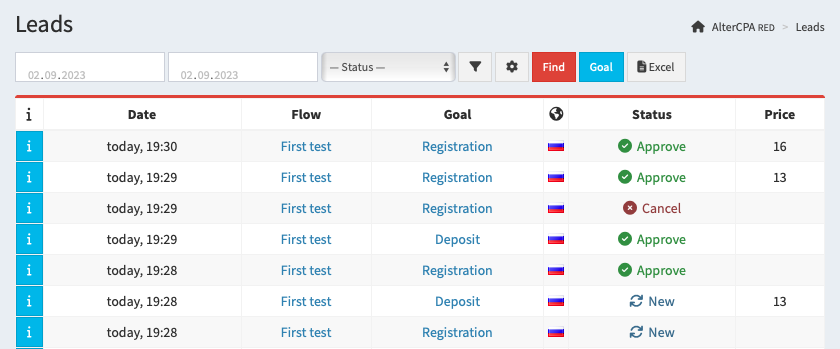
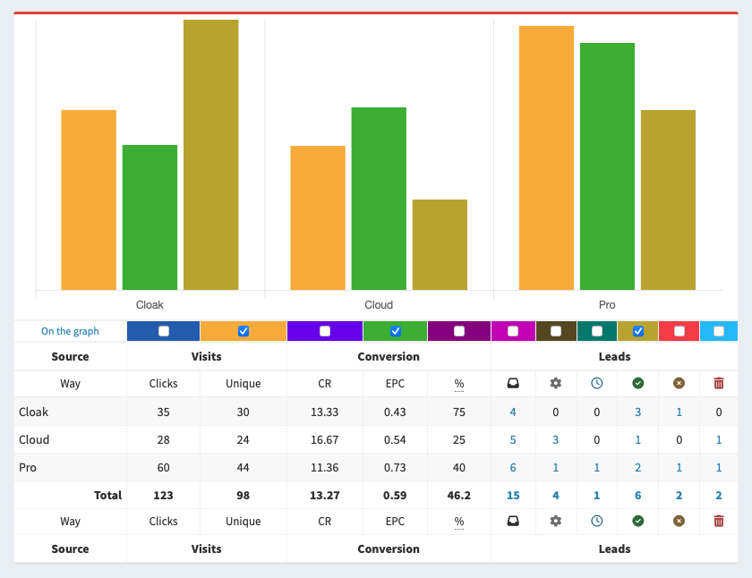
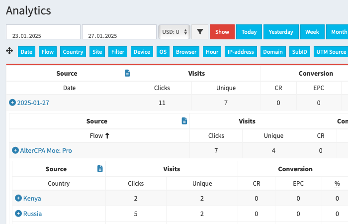
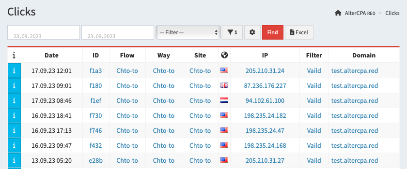

# Statistics and analytics

The tracker provides two main sections of statistics - detailed data on leads and summary statistics on clicks. Detailed click data is available in the log.

> **Important!** Dates are not the only way to group statistics! Just select the criterion you need in the first drop-down list of filters. When working from a mobile device, open the filter settings by the button. And you will see a full set of all available items by which you can group statistics.

## Lead statistics

All postback applications are collected in the "[Leads](/track-leads)" section of the tracker.

All leads are organized in a table that shows the following information:

- The date when the lead entered the tracker. It does not change when the lead status changes.
- The flow and way this lead came from.
- Storage site, if it was used when submitting the lead.
- The internal status of the lead (new, hold, approve, cancel or trash) and the actual status that was received in the postback.
- Country and IP address of the lead received.
- Lead price (displayed regardless of status).
- Data about the lead source: domain, subid, UTM tags.
- Internal data of the lead: name, phone, email, comment.

You can choose the visibility of columns in the table by clicking the gear button. Regardless of which columns you have selected in your report, when you download a file in Excel, it will contain all the available data.

> **Important!** The `hold` status in our tracker **is not a pending status**. This is a delayed confirmation - leads that are confirmed but not yet paid. It is involved in the calculation of approval and EPC. Don't use it as pending status.

By the `[i]` button, you can view additional information about the incoming lead:

- Click ID where the lead came from.
- User-Agent and its derived browser and operating system.
- Additional lead fields passed during creation.

Search for leads is carried out by status and the date of lead creation. To search for leads by other criteria, click on the funnel button and an advanced search form will open in front of you. It contains: flow, geo, site, goal, domain, tags, IP, lead ID, devices and filtering results.

## Click statistics

Summary analytics on clicks and leads is available in the "[Statistics](/track-stats)" section. It collects data about your visits and leads.

The statistics report is generated according to one of the selected parameters:

- **Lead arrival time**: Date and Hour.
- **Lead Source**: Flow, Way, and Site.
- **Traffic Filtering Result**: Filter.
- **Geography of the lead**: Country and IP address.
- **Lead Sender**: Device, OS, Browser.
- **Tags**: Domain, SubID, UTM Source, UTM Content, UTM Term, UTM Medium.

You can choose the period for displaying the report on the selected parameter and the currency in which the amounts will be displayed. The funnel button opens a list of advanced filters: flows, geo, sites, tags, devices, filters. The graph for the selected indicator is hidden by default, to open it, click on the "Show" button at the top of the table.

> **Important!** The `hold` status in our tracker **is not a pending status**. This is a delayed confirmation - leads that are confirmed but not yet paid. It is involved in the calculation of approval and EPC. Don't use it as pending status.

By default, the lead currency is not taken into account at all and payouts are simply summed up. When choosing a currency, all amounts are converted to it. The default currency is USD.

The following fields are used in the statistics table:

- Total visits and unique clicks.
- Number of jumps to the second step (landing) and their percentage of unique visits.
- CR and CRt: conversion percentage from unique clicks to valid and any leads.
- EPC: the ratio of earnings to unique clicks.
- EPL: the ratio of earnings to approved and holded leads.
- Approve: the ratio of confirmed and hold leads to valid leads.
- Approve with trash: the ratio of confirmed and hold leads to the total number of leads.
- Total number of leads received.
- Valid leads: the number of incoming leads excluding trash.
- Number of leads by status: new, hold, approve, cancel and trash.
- Finance: total payout amount for leads in hold and approve statuses, separate amounts for these statuses.
- ROI: cost per click, amount of expense and profit, percentage of earnings.
- CPL: total cost of any, valid (CPLv) or approved (CPLa) lead.

If you enable goal support, the following will also be available for each goal:

- Metrics: CR, EPC, EPL, two types of approval.
- Number of leads in total, valid and by status.
- Finance: total, hold and approve.

The visibility of the columns is adjusted using the button with gears. Goal breakdown columns are hidden by default, you need to manually select them after activating the goal.

## Traffic analytics

The analytics section is an alternative way to display click statistics. It allows you to hierarchically organize statistics and view them in depth. There are no graphics in this report, but all filters and columns are available.

Move the tags with the mouse in the order you need and click on the check mark. A hierarchical report will be built for the specified tag sequence. Click on the plus sign in the statistics line to expand it further. If a filter is specified for any of the tags, it will be skipped in the hierarchy.

## Setting goals

When working with statistics, you can enable goal support. Goals will allow you to further break down leads into groups and analyze the necessary indicators within these groups.

[Learn more about goals](goal.md)

## Clicks log

All visits that the tracker records are saved in the tracker's "Clicks" log.

The clicks are organized into a table that shows the following information:

- The date the click entered into the tracker.
- Click ID by which you can find created leads.
- Marks of a unique click and jump to the second step (landing page).
- The flow through which this click came and the path where it was sent.
- Site from storage, if it was used when sending the click.
- Click filtering results: valid or blocked click.
- Country and IP address of the click.
- Click price, if it was received during the visit or via the API.
- Data about the source of the click: domain, subid, UTM tags.

You can select the visibility of columns in the table using the gear button. Regardless of which columns you select in your report, when you download the file to Excel, it will contain all the available data.

By the `[i]` button, you can view additional information about the click:

- Advertising click ID and additional fields.
- User-Agent and its derived browser and operating system.

Search for clicks is carried out by filtering status and the date of click creation. To search for clicks by other criteria, click on the funnel button and an advanced search form will open in front of you. It contains: flow, geo, site, goal, domain, tags, IP, click ID and devices.
