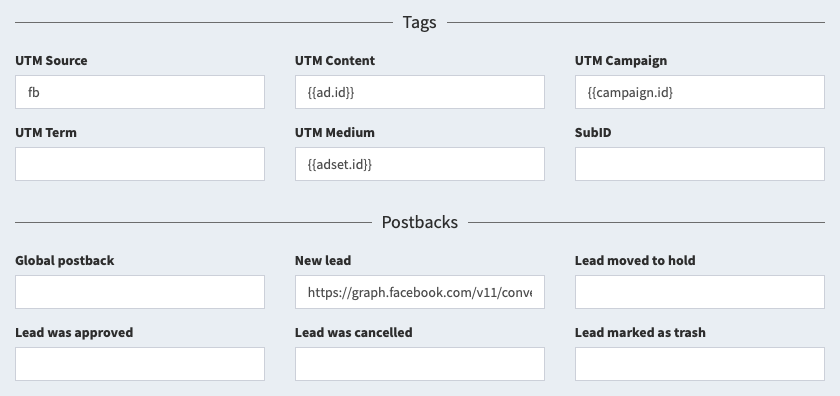

# Outgoing postbacks

You can send postback requests to third-party services when leads change. This is useful for integrating with various ad networks and optimizing ads. Postbacks are configured within the flow.

::: card
<a id="auto"></a>

## Automatic setup by template

You don't have to fill in all the tags yourself. In the "Tags" section, click "Configure traffic source", select the desired option and click "Save". Sometimes, we will ask you for a couple of parameters:

- **Token** - required for sending optimization postbacks. Most often, you can find it in your personal account or extract it from a postback sample.
- **Domain** - in some cases, in addition to the token, the domain for the postback also changes. Extracted from the postback sample, only the domain itself is specified, not the link.
- **Pixel** or **Identifier** - the number of your counter or campaign, which is being optimized.

After saving the form, all tags and postbacks will be substituted automatically. Just copy the new flow link and use it to fill the traffic.
:::

<a id="tags"></a>

## Available tags

In the flow settings, you can specify tags and macros to track traffic. The following parameters are available to you, which are collected in statistics:

- Tag **SubID** and its parameter `subid`.
- Tag **UTM Source** and its parameter `utm_source`.
- Tag **UTM Campaign** and its parameter `utm_campaign`.
- Tag **UTM Content** and its parameter `utm_content`.
- Tag **UTM Term** and its parameter `utm_term`.
- Tag **UTM Medium** and its parameter `utm_medium`.
- The click price in the `cpc` parameter and its currency in the `currency` parameter.

Statistics are generated only for these six tags. Other parameters and tags are ignored when recording a visit and do not participate in the creation of statistics. It makes no sense to use some `sub1` or `s2`, we will ignore them.



You can also use additional parameters that are not used in statistics, but can be used in postbacks, for example, to optimize mobile applications or ad networks:

- Ad click ID from parameters: `fbclid`, `gclid`, `adclid`, `clid`, `adid`.
- Custom data #1 from parameters `data1` or `d1`.
- Custom data #2 from parameters `data2` or `d2`.
- Custom data #3 from parameters `data3` or `d3`.
- Custom data #4 from parameters `data4` or `d4`.
- Custom data #5 from parameters `data5` or `d5`.

<a id="postback"></a>

## Available events

You have several options for setting up postbacks within a flow:

- **Global postback**: fires every time there is any change to the lead, including the creation of the lead and changes to any parameters. Works in conjunction with other postbacks, does not replace them.
- **New lead**: triggers only when a lead is created, regardless of the status and goal of this lead.
- **Lead moved to hold, approved, rejected, marked as trash**: triggered only when the lead status is changed to selected, but not when a lead is created in this status.

## Available macros

Data is inserted into the postback using macros in curly braces:

- `{id}` - numeric identifier of the lead.
- `{flow}` - character identifier of the flow.
- `{way}` - numeric identifier of the way.
- `{site}` - numeric identifier of the site.
- `{click}` - character identifier of the click.
- `{uid}` - unique lead identifier.
- `{time}` - lead arrival time in Unix Timestamp.
- `{now}` - current time in Unix Timestamp.
- `{utm_source}` - UTM Source tag.
- `{utm_campaign}` - UTM Campaign tag.
- `{utm_content}` - UTM Content tag.
- `{utm_term}` - UTM Term tag.
- `{utm_medium}` - UTM Medium tag.
- `{domain}` - domain.
- `{subid}` - SubID tag.
- `{adid}`, `{fbclid}`, `{gclid}`, `{adclid}`, ` {clid}` - click ID in the ad network.
- `{data1}` - custom data field 1.
- `{data2}` - custom data field 2.
- `{data3}` - custom data field 3.
- `{data4}` - custom data field 4.
- `{data5}` - custom data field 5.
- `{status}` - standard lead status (`new`, `hold`, `approve`, `cancel`, `trash`).
- `{custom}` - initial text status of the lead.
- `{goal}` - character identifier of the goal.
- `{name}` - customer's name.
- `{phone}` - customer's phone number.
- `{email}` - customer's email.
- `{comment}` - lead comment.
- `{geo}` - ISO code of the country of the lead.
- `{ip}` - IP address of the lead.
- `{ua}` - User Agent.
- `{price}` - lead price.
- `{currency}` - lead price currency (`usd` by default).
- `{meta:xxx}` - the value of an arbitrary field with the name `xxx`.

## Facebook events

The server pixel for Facebook is installed in the "New" postback and can look like this:

```
https://graph.facebook.com/v18.0/PIXEL/events|POST|access_token=TOKEN&data=[{"action_source":"website","event_name":"Lead","event_time":{now},"user_data":{"external_id":"{id}","client_ip_address":"{ip}","client_user_agent":"{ua}","fbc":"fb.1.{now}.{adid}","fbp":"fb.1.{now}.{id}"}}]
```

In this link you need to set your data instead of texts:

- `PIXEL` - identifier of your pixel, for example `1234567890`.
- `TOKEN` - your token, for example `EAABabcde`.
- `Lead` - the name of the event that you need to send.

Specifying the pixel ID and token is mandatory; changing the event is optional.

<a id="send"></a>

## Sending leads

You can send leads from the tracker to the affiliate network. Please note that this submission format will not be guaranteed or traceable. We do not recommend using this method in your work.

Create a "Thank you" page that will request a standard postback and submit the data provided by the user in a form on the site. To send leads, fill out the "New lead" postback and include all the lead data that you collect on the "Thank you" page. For example, such a postback will send a lead to a network based on AlterCPA:

```
https://domain.com/api/wm/push.json?id=TOKEN&offer=1&flow=2&name={name}&phone={phone}&ip={ip} &country={geo}&sub1={click}
```

This submission format may not be suitable for you, as the target network only accepts POST requests. To implement them, use the following instructions.

## POST request

By default, postbacks are sent as GET requests. If absolutely necessary, you can split the postback into a link and a POST part of the request. To do this, in the middle of the link, insert the macro `|POST|`, before which there will be a link (the GET part of the request), and after which the data will go. For example:

```
https://track.er/postback?code=abc|POST|click={click}&name={name}
```

Data is transmitted in the classic URL Encoded format, sending JSON using this method is not supported.

If for some reason you need to send a request in JSON format, instead of the `|POST|` macro, use the `|JSON|` macro with the same principles. For example:

```
https://track.er/postback|JSON|{"foo":"bar","click":"{click}"}
```

This macro will split the link into the link and the JSON part and send a request with the header `Content-type: application/json`.

> **Important!** Please note that this functionality was created for fun and we do not think that you will seriously use it in your work. You won't? Is it true? Oops.

## Postbacks log

All postbacks that are sent from the tracker via links in the flows are stored in the "Outgoing postbacks" subsection of the "Logs" section. The following information about postbacks is available to you:

- **Time of sending postback** - you can search for postbacks by the date range when they were sent.
- **Postback event** - shows which field the postback was taken from.
- **Flow**, **click**, **lead** and **site** - identifiers from the lead for which the postback was sent. You can filter postbacks by a specific ID.
- **Type** - method of sending postback: classic GET or POST in standard format or JSON.
- **URL** - the link to which the request was sent. Do not copy this link to check, it contains special characters. Click on "Show" and copy the link from there.
- **Response code** - a good code is 200, no response is zero, everything else depends on the target site.

You can view detailed information about the request if you click on "Show" in the "Info" column:

- **URL** - the full link used to make the request.
- **POST** - data in the POST block that was sent to the server. JSON is always used to display data because it looks nice. In reality, data is also sent in urlencoded format if the JSON format is not specified.
- **Server response** - data sent by the server in response to a request, without specifying headers. If the server responds in JSON format, the data is transformed for beautiful display.
