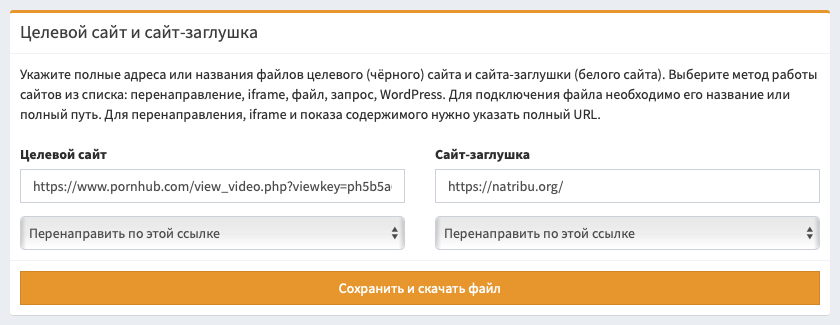

# Вставка фильтра на сайт

Самый простой и удобный метод установки фильтра на сайт - скачать готовый файл фильтрации. Он сформируется для вас автоматически в зависимости от выбранных настроек.

::: card
## Что такое целевой сайт и заглушка?

Целевым сайтом и сайтом-заглушкой может быть определённый файл или URL.

- **Целевой сайт**, иногда называемый "чёрным" сайтом - это ваш ценный ресурс, который необходимо показать посетителям и скрыть от ботов, спамеров и злоумышленников.
- **Заглушка** или "белый" сайт - это ресурс, который видят злоумышленники и боты вместо целевого сайта. Это может быть поддельный сайт, страница с ошибкой, сторонний ресурс или ханипот.

При работе с URL, обязательно указывайте полную ссылку с `https://` в начале. При работе с файлом, не указывайте ссылку на него, указывайте относительный путь к файлу.
:::

## Методы работы сайтов

Вы можете выбрать свой метод работы для целевого сайта и заглушки. Сервис автоматически сформирует для вас оптимальный файл в зависимости от выбранного метода.

> **Важно!** Если вы меняете метод работы сайта-заглушки или целевого сайта, вам нужно повторно скачать новый файл фильтра! При смене иных настроек, например, ссылок или фильтров, новый файл скачивать не нужно.

### Перенаправить по ссылке (302 редирект)

Посетитель перенаправляется по указанной ссылке с помощью заголовка `302 Found`. Это стандартный и самый распространённый метод работы с редиректами.

> Не рекомендуется использовать 301 и 302 редиректы в сочетании с другими методами, поскольку некоторые рекламные сети могут расценить разные методы показа как взлом сайта.

### Перенаправить по ссылке и склеить (301 редирект)

Посетитель перенаправляется по указанной ссылке с помощью заголовка `301 Moved Permanently`. Этот вид редиректа кешируется, даже если в настройках потока включена ротация.

> Существует поверье, что данный метод редиректа позволяет склеить вашу ссылку с целевым доменом и в рекламных объявлениях будет показываться именно целевой домен. Мы не рекомендуем верить этим слухам.

### Перенаправить через отдельную страницу (meta-редирект)

Пользователь видит страницу "Идёт проверка вашего браузера" и перенаправляется на целевой сайт спустя секунду после её отображения. При этом браузер не получает прямых заголовков 301 или 302 редиректа, все перенаправления выполняются с помощью HTML.

> Рекомендуется использовать этот вариант перенаправления, если вы сочетаете разные методы работы, например, показ содержимого для одних путей и редиректы для других. Это позволит избежать блокировки рекламной кампании, например, в Google с пометкой "Вредоносное ПО".

### Перенаправить скриптом (JS-редирект)

Пользователь загружает страницу без содержимого и моментально перенаправляется на целевой сайт. При этом браузер не получает прямых заголовков 301 или 302 редиректа, все перенаправления выполняются с помощью JS-скрипта.

> Этот вариант можно использовать наряду с meta-редиректом, чтобы избежать блокировки за "Взломанный сайт". Но данный метод иногда может не срабатывать из-за блокировщиков рекламы в браузерах.

### Открыть файл с таким названием

Скрипт откроет файл, расположенный на сервере, PHP-методом `include`. В поле сайта необходимо указать название файла, если он находится в той же папке, что и скрипт, или полный путь к файлу. Вы можете изменить это название на лету в настройках кампании, скачивать новый файл при этом не потребуется.

> Не используйте стандартные названия файла: `target.php`, `dummy.php`, `black.php`, `white.php`, `bl.php`, `wh.php`, `w.php` или `b.php` - чтобы злоумышленник не смог получить доступ к вашему сайту простым перебором. Если название файла не указано, используется `black-index.php` и `white-index.php` для целевого сайта и заглушки соответственно.

При работе с локальным файлом в целевом сайте, вы можете использовать макрос `{geo}`, чтобы открывать разные целевые сайты в зависимости от страны посетителя. Например, `black-{geo}.php` откроет файл `black-fr.php` при визите из Франции. Используйте только с целевым сайтом и только при указанном списке разрешенных стран.

### Показать ссылку в IFrame

Пользователь видит страницу без контента, поверх которой на весь экран открывается iframe с сайтом, указанным по ссылке.

> Не все сайты поддерживают работу внутри iframe из-за ограничений безопасности. При работе с iframe, рекомендуется открывать все ссылки в новом окне, добавив к ним атрибут `target="_blank"` или разрешить отображение всех сайтов во фреймах с помощью заголовков.

### Показать контент по ссылке (cURL)

Скрипт загружает контент по ссылке и показывает его пользователю. При этом в контент добавляется тег `base`, который подменяет все пути к ресурсам. Так все ресурсы (картинки, скрипты, стили) показываются на сайте без необходимости менять его содержимое. Поддерживается передача GET и POST запросов.

> Существует поверье, что наличие тега `base` в содержимом сайта негативно сказывается на одобрение сайта поисковыми системами. Мы не рекомендуем слушать этот бред. Показ контента по ссылке - это самый лучший вариант работы!

### Показать контент без обработки

Контент загружается по ссылке без изменения путей и показывается посетителю.

> При работе с этой методикой необходимо указывать абсолютные пути с доменом для всех ресурсов: картинок, скриптов, стилей, шрифтов, иначе они не будут загружены. Поля `action` в формах также должны иметь абсолютные пути.

### Встроить в WordPress

Вы можете встроить свой фильтр напрямую в сайт на WordPress. Для установки, загрузите файл `index.php` на сервер вместо такого же файла WordPress. Обязательно отключите кеширующие плагины, потому что они будут мешать работе фильтра.

> **Важно!** Вы не можете использовать WordPress одновременно на целевом сайте и сайте-заглушке, у вас просто откроется один сайт. Используйте разные методы работы для целевого сайта и заглушки. Рекомендуется использовать WordPress только на сайте-заглушке. Для целевого сайта используйте редирект или CURL.

### Показать пустую страницу

Вместо содержимого по ссылке, показывается пустая страница без контента. Не отправляются даже стандартные HTML-теги для пустой разметки. Статус ответа всегда `200`.
