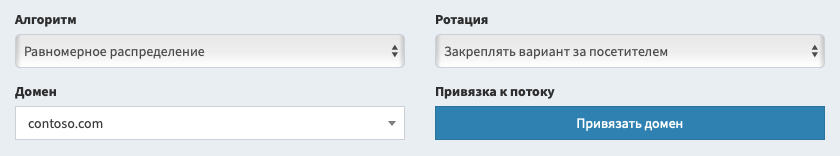

# Парковка доменов

Мы не рекомендуем использовать системный домен для работы с трафиком. Вам нужно парковать свои домены. Количество паркованных доменов ничем не ограничено, вы можете использовать один поток с неограниченным количеством доменов.

## Общие принципы

Чтобы припарковать домен и использовать его в потоках, выполните следующее:

1. **Добавьте домен в систему**. Для этого зайдите в раздел "[Паркованные домены](/track-domain)" вашего личного кабинета и в поле "Домен" нужного типа укажите полное наименование вашего домена. Указывать www не нужно, использовать http:// также не нужно.
2. **Настройте DNS-серверы домена**. Это действие выполняется в личном кабинете вашего регистратора домена. В настройках DNS домена укажите использование бесплатных DNS вашего регистратора. Если ваш регистратор не предоставляет бесплатных DNS, рекомендуем воспользоваться [CloudFlare](https://www.cloudflare.com), настройки указаны ниже.
3. **Настройте DNS-зону вашего домена**. Это действие также выполняется на стороне вашего регистратора или CloudFlare. Перейдите в редактор DNS-зоны в личном кабинете регистратора (не перепутайте его с настройкой DNS-серверов, вам нужна именно настройка DNS-зоны).
  - Удалите все имеющиеся записи типа A, AAAA и CNAME, которые указывают на требуемый вам домен. Для корневого домена их названием будет @ или имя домена, для поддомена - соответственно, имя поддомена.
  - Добавьте новую запись типа A с этим названием и значением, указанным в разделе парковки доменов.
  - Если вам требуется поддержка IPv6, добавьте новую запись AAAA с этим названием и IPv6-адресом вашего сервера.
  - Не добавляйте эти записи для поддомена www, поскольку его использование не поддерживается. Вы можете использовать www-поддомен в качестве вашего целевого сайта, указывающим на ваш основной сервер.
4. **Дождитесь окончания привязки домена**. В зависимости от различных условий, включающих фазу луны и напряженность торсионных полей, привязка домена может занять от нескольких минут до трёх суток. Вы можете проверить, привязался ли домен, кнопкой "Проверка".

В таблице паркованных доменов будет указан текущий статус привязки. Рекомендуется начинать работу с трафиком только в том случае, если в колонке "Статус" указано "Привязан". В течение нескольких часов после того, как статус домена меняется на "Привязан", он получает SSL-сертификат. Домен с активным SSL-сертификатом получает значок замка в названии. Вы можете ускорить процесс проверки домена кнопкой "Проверка" (нажимайте не чаще чем раз в 15 минут).

## Куда парковать?

Список адресов для парковки указан в разделе "Домены". Список записей, которые нужно завести домену, вы можете просмотреть по кнопке со значком сервера.

Вам доступны несколько вариантов парковки доменов: центральный сервер трекера, ваше личное или командное хранилище сайтов, один из фронт-серверов или нода PrivateFlare.

1. **Центральный сервер.** Для парковки используйте А-запись с IP вашего сервера. При необходимости, вы можете также добавить АААА-запись с IPv6 вашего сервера, при наличии. Парковка на центральный сервер доступна всегда, установка дополнительного оборудования не требуется.
2. **Хранилище сайтов.** IP-адреса для парковки - это адреса вашего личного или командного сервера. Для парковки, необходимо [завести и настроить сервер хранилища](sites.md). Своё хранилище уменьшает шансы получить бан от рекламных сервисов и снижает общее количество проблем с блокировками.
3. **Фронт-сервер.** IP-адреса для парковки - это адреса одного из личных или командных фронт-серверов. Фронт-сервер можно развернуть по инструкции из [настроек хранилища сайтов](/track-sites/setup). Количество фронт-серверов не ограничено.
4. **PrivateFlare.** IP-адреса для парковки - это адреса нод PrivateFlare. Обычно список адресов выгружается автоматически и показывается в настройках доменов.

Вы можете одновременно использовать любые варианты парковки. В течение пары часов домен будет привязан с одного сервера на другой и получит SSL-сертификат.

> Администратору на заметку: вам стоит подготовить список IP-адресов, на которые пользователи будут парковать домены. Список адресов указывается в общих настройках трекера или в настройках личного и командного хранилища сайтов. Список адресов указывается через запятую, можно использовать адреса IPv4 и IPv6.

## Привязка домена к потоку

Обычно на главной странице паркованного домена отображается случайная ошибка, а все потоки открываются по символьному пути. Но вы можете прикрепить какой-нибудь из потоков напрямую к главной странице домена.

Есть два варианта этой настройки:

1. При работе с потоком, выберите в его настройках нужный паркованный домен и нажмите на кнопку "Привязать". Ссылка потока начнёт вести на главную страницу домена.
2. При работе с доменами, найдите нужный домен и нажмите на кнопку "Привязать". Откроется меню выбора потока. Найдите нужный вам поток и нажмите "Прикрепить".

Один и тот же поток можно прикрепить к любому количеству паркованных доменов. При смене домена в настройках потока, старый домен не открепляется.

## Мониторинг доменов

Трекер автоматически проверяет активность доменов и старается следить за сроками из регистрации и истечения. Вы можете получать уведомления на почту, прикреплённую к аккаунту, или через Telegram. Настройка уведомлений осуществляется по кнопке с шестерёнкой.

- Проверка доменов на корректность парковки выполняется раз в несколько часов. Если домен сменил статус, трекер отправляет уведомление в реальном времени. Стоит опасаться только статуса "Ошибка", статусы "Активный", "OK+SSL" и "Не туда!" - это нормальные рабочие статусы.
- По истекающим доменам каждую полночь отправляется сводная информация. Трекер собирает домены, которые истекают в течение месяца или истекли не больше месяца назад, и направляет вам их список. Функция доступна далеко не по всем доменным зонам. Некоторые зоны, например info, не раскрывают данные о сроке продления домена через whois.

Чтобы активировать уведомлления в Telegram, вам нужен любой бот и идентификатор чата, в который эти уведомления отсылать. Завести бота можно с помощью [@BotFather](https://t.me/BotFather), идентификатор чата указывается в его профиле в поле Peer ID. Можно отправлять уведомления в несколько чатов, для этого укажите их через запятую. Идентификатор группы указывается со знаком минус.

## Особенности парковки в CloudFlare

Сервис CloudFlare предоставляет идеальные DNS-серверы для ваших доменов. При работе с этим сервисом, существует два варианта настройки, для которых необходима следующая подготовка:

1. **Зарегистрируйтесь в CloudFlare**. Сделать это можно [здесь](https://dash.cloudflare.com/sign-up). Не покупайте платную или расширенную подписку, она вам не потребуется.
2. **Добавьте свой домен в CloudFlare**. Для этого воспользуйтесь кнопкой Add a Site на главной странице личного кабинета CloudFlare. При добавлении, выберите бесплатный тарифный план. Платная подписка вам не потребуется.
3. **Укажите DNS CloudFlare для своего домена**. При добавлении сайта CloudFlare предложит вам сменить DNS-серверы своего домена на свои. Это выполняется в личном кабинете вашего регистратора доменов.
4. **Настройте DNS-зону вашего домена**. Это действие также выполняется на стороне CloudFlare. Перейдите в редактор DNS-зоны в личном кабинете.
  - Удалите все имеющиеся записи типа A, AAAA и CNAME, которые указывают на требуемый вам домен. Для корневого домена нужным названием будет @ или имя домена, для поддомена - соответственно, имя поддомена.
  - Добавьте новую запись типа A с этим названием и значением, указанным в разделе парковки доменов.
  - Если вам требуется поддержка IPv6, добавьте новую запись AAAA с этим названием и IPv6-адресом вашего сервера.
  - Не добавляйте эти записи для поддомена www, поскольку его использование не поддерживается. Вы можете использовать www-поддомен в качестве вашего целевого сайта, указывающим на ваш основной сервер.

### CloudFlare как DNS-сервер

При данном варианте настройки вы используете CloudFlare как вашего DNS-провайдера. Это позволяет пробросить домены напрямую на сервер AlterCPA Lite. В разделе DNS-записей CloudFlare при этом должен быть включен режим "DNS Only" вместо "Proxied". Другие настройки не требуются.

### CloudFlare как полноценный прокси

При данном варианте настройки весь трафик пропускается через сервис CloudFlare и необходимо отключить кеширование.

1. **Настройте DNS-зону вашего домена**. Убедитесь, что у добавленной записи выбран статус DNS and HTTP proxy (рыжее облачко со стрелкой насквозь), а не DNS only (серое облачко со стрелкой в обход).
2. **Настройте шифрование**. Перейдите в раздел Crypto настроек вашего домена и укажите следующие настройки:
				
				Остальные параметры оставьте без изменений.
  - **SSL**: Flexible
  - **Always use HTTPS**: On (если вам нужна поддержка HTTPS)
  - **Automatic HTTPS Rewrites**: On (если вам нужна поддержка HTTPS)
3. **Настройте защиту**. Перейдите в раздел Firewall и установите Security level в Essentially Off.
4. **Добавьте правило обхода кеша**. Перейдите в раздел Page Rules настроек вашего домена и нажмите на Create Page Rule со следующими настройками:
				
				Нажмите Save and deploy для окончания настройки.
  - **If the URL matches**: укажите свой домен и путь `/*`, чтобы получилось `domain.com/*`
  - **Browser integrity check**: Off
  - **Cache level**: Bypass
  - **Disable security**: Security is disabled
