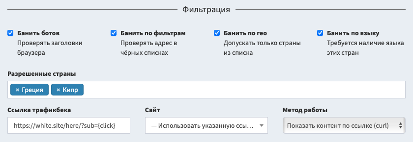
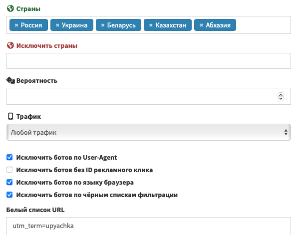

# Фильтрация трафика

Трекер располагает встроенными средствами фильтрации трафика. Они позволяют заблокировать ботов и спамеров по различным чёрным спискам AlterCPA Lite.

## Настройка фильтрации

Поток можно подключить к существующей кампании фильтрации трафика. Поток будет использовать все настройки географии, языков, особых фильтров, операционных систем, браузеров, протоколов, чёрных и белых списков. При этом игнорируются настройки целевого сайта и заглушки, их методы работы и сама активность фильтра. Данные о проверке каждого визита сохраняются в журнале кликов кампании.

Вы также можете настроить простую фильтрацию вручную. Ручные фильтры трафика настраиваются внутри потока в разделе "Фильтрация". Вам доступны следующие глобальные настройки:

- **Боты**: блокировка выполняется по известным заголовкам браузера, которые используют различные боты, в том числе спай-сервисы и поисковые роботы.
- **Чёрные списки**: основной IP-адрес посетителя проверяется по умным чёрным спискам.
- **Страна**: блокируются визиты, не входящие в список разрешенных стран.
- **Язык**: блокируются визиты, у которых нет поддержки хотя бы одного из языков разрешенных стран.
- **ID рекламы**: блокируются визиты, если не найден идентификатор клика популярных рекламных сетей, например Google, Facebook или Bing.
- **Разрешенные страны**: список стран, посетители и языки из которых разрешены.

Если визит блокируется ручными фильтрами или кампанией фильтрации, пользователю показывается трафикбек. Это аналог сайта-заглушки в кампании фильтрации. Доступны следующие настройки:

- **Сайт.** Один из сайтов, расположенных [в вашем хранилище](sites.md). Если выбран, ссылка и метод работы игнорируются.
- **Ссылка трафикбека.** URL или путь к файлу, который показывается при блокировке визита. Если не указана ссылка или сайт, пользователю показывается случайная HTTP-ошибка.
- **Метод работы.** Один из вариантов отображения трафикбека, подобно описан в разделе "[Методы работы](method.md)".

При срабатывании каждого из фильтров, в журнале фильтрации будет зафиксирован его вид: боты, гео, язык или чёрный список. Просмотреть данные о срабатывании фильтров вы можете в разделе "[Статистика](/track-stats?item=filter)" с выбранным критерием "Фильтр".

> Существует поверие, что заголовки и cookie, которые отправляет трекер, могут влиять на качество фильтрации. Чтобы гарантировано избежать бана вашей рекламной кампании, вы можете активировать режим "Не отправлять дополнительные заголовки и cookie посетилетям". Из минусов: эта функция также отключает учёт уникальности кликов и сломает механизм ротации путей. В большинстве случаев это не критично. Также можно запретить отправку заголовков только для трафикбека.

## Фильтры в путях

Внутри каждого пути встроены дополнительные фильтры трафика:

- **Разрешенные и запрещенные страны.** Позволяет не только разрешать, но и исключать страны. Удобно для создания путей, которые обслуживают все страны кроме выбранных.
- **Вероятность.** Не запрещает проход по пути, но позволяет сократить или увеличить число посетителей.
- **Трафик.** Определяет, с каких устройств можно открыть этот путь: десктоп, мобильные, iOS/Android.
- **Исключить ботов по User-Agent, языку и чёрным спискам фильтрации.** Работает по тем же принципам, что и глобальная блокировка ботов.
- **Исключить ботов без ID рекламного клика.** Проверяет наличие стандартного параметра рекламных сетей и блокирует трафик, который пришёл в обход рекламы.
- **Белый и чёрный список URL.** Позволяет задавать произвольные слова, которые должны или не должны присутствовать в ссылке. Задается по одному слову в строке.

Если ни одни из путей не подошёл посетителю, он будет направлен на трафикбек. В журнале фильтрации это событие будет зафиксировано как "Трафбек".
