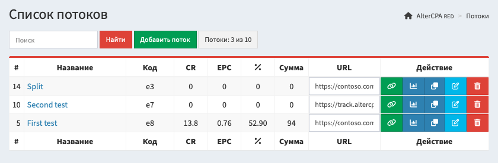
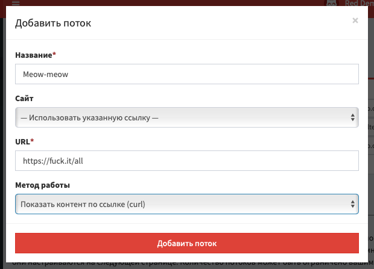
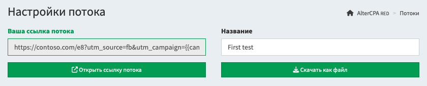

# Потоки и трафик

Потоки - это основа работы трекера. Весь трафик мы пропускаем именно через потоки. Количество доступных потоков не ограничено. Количество трафика ограничено только мощностью вашего основного сервера.

## Создание потока

Работа с потоками осуществляется в разделе "[Потоки](/track-flows)" трекера.

В нём представлена таблица с созданными потоками, в которой указаны:

- **Название потока**: используется для удобства.
- **Символьный код потока:** используется в ссылках и [API](api.md), не меняется.
- **Конверсия, EPC и аппрув**: актуальные показатели потока за последние три дня.
- **Сумма**: общий заработок по потоку за все время его работы.
- **URL** и **Копировать**: ссылка потока для заливки трафика (с учётом домена) и кнопки открытия ссылки в новом окне и копирования ссылки в буфер обмена.
- **Статистика**: сводная таблица показателей по выбранному потоку.
- **Клонировать**: создает новый поток с тем же составом путей и настройками.
- **Настройки**: открывает страницу работы с потоком и создания путей.
- **Удаление**: полностью удаляет поток без возможности восстановления. Статистика при этом не исчезает из базы.

Чтобы создать новый поток, нажмите на "Добавить поток" над таблицей. Вам необходимо ввести его название и настроить первый путь, на который и будет идти трафик. В качестве пути может быть [сайт](sites.md) или ссылка с выбранным [методом работы](method.md).

После создания потока, вы перейдете на страницу его настроек. Здесь вы можете добавить новые пути, настроить [фильтры трафика](filter.md), подключить [интеграцию](postback.md) с партнёрской сетью, добавить [постбеки и метки](tags.md).

> Вы можете создать поток в упрощённом виде, без режима сплит тестирования. В такой конфигуации, вам будет доступен только один путь в потоке без дополнительных настроек. Это удобно для новичков. Переключить поток в полноценный режим можно в любой момент одной кнопкой.

## Пути в потоке

Поток состоит из одного или [нескольких путей](split.md). Первый путь добавляется автоматически при создании потока. Чтобы изменить его ссылку, сайт или метод работы, нажмите на кнопку правки в списке путей.

Для создания нового пути в потоке, нажмите на "Добавить новый путь" под таблицей. Вам нужно будет указать название, выбрать [сайт из хранилища](sites.md) или указать ссылку и её [метод работы](method.md).

У пути доступны следующие настройки:

- **Название** - используется для удобства поиска. У первого пути совпадает с названием потока.
- **Сайт** - привязанный к пути [сайт из хранилища](sites.md). Один сайт можно привязывать к любому числу путей, в том числе внутри одного потока.
- **URL** - если не выбран сайт, используется ссылка или путь к файлу.
- **Метод работы** - один из [доступных методов](method.md), по которому ведется работа со ссылкой.
- **Страны** - список гео, для которых показывается этот путь. Позволяет создавать разные пути под каждое гео.
- **Исключить страны** - список гео, для которых этот путь скрывается. Удобно для создания резервного пути.
- **Вероятность** - шанс показа именно этого пути. Указывается в процентах от 1 до 100. Если общая сумма всех вероятностей больше ста процентов, шансы нормализуются до сотни. Если меньше 100% - остаток разделяется между путями без указания вероятности.
- **Трафик** - устройства, для которых будет показываться этот путь: десктоп или мобильный.
- **Исключить ботов по критериям** - настройки [фильтрации трафика](filter.md) для выбранного пути.
- **Чёрный и белый списки URL** - фильтры по наличию или отсутствию ключевых слов в ссылке.
- **Галочка активности** - если отсутствует, трафик на данный путь не поступает.

Вы можете дополнительно настроить "второй шаг" в пути. Если вы работаете со связкой прелендинг-лендинг, ваш прелендинг будет основным шагом пути, а лендинг - вторым. Не забудьте получить на прелендинге ссылку второго шага через макрос `{next}` в ссылке или коде сайта. Параметры второго шага аналогичны первому:

- **Сайт второго шага** - привязанный к пути [сайт из хранилища](sites.md).
- **URL второго шага** - если не выбран сайт, используется ссылка или путь к файлу.
- **Метод работы** - один из [доступных методов](method.md), по которому ведется работа со ссылкой.

Под таблицей со списком путей располагаются [настройки их ротации](split.md). Вы можете выбрать алгоритм, по которому трекер будет выбирать оптимальный путь для посетителя по методу "многоруких бандитов". По умолчанию, выбранный путь закрепляется за клиентом, но вы можете активировать ротацию и каждый визит показывать клиенту новый путь.

[Подробнее о путях и сплит-тестах](split.md)

## Ссылка и локальный файл

Вам доступны два основных метода использования потока: работа со ссылкой и работа с локальным файлом.

Локальный файл, ссылка через основной сервер, ссылка через хранилище сайтов - все они работают одинаково и используют один и тот же механизм реализации. Вы можете применять любой удобный вам вариант с одинаковым результатом.

- **При работе по ссылке**, вы используете для заливки трафика ссылку потока. Она может использовать любой из припаркованных вами [доменов](domain.md). Ссылки можно приклеивать к главной странице домена. За обслуживание ссылки отвечает центральный сервер или ваше [хранилище сайтов](sites.md).
- **При работе с локальным файлом**, вы скачиваете файл клиента и размещаете его на своём сервере или обычном хостинге. За аналитику визитов отвечает сам трекер, за загрузку содержимого и показ контента - файл на сервере. Очень удобный вариант для распределения ответственности на разные серверы.

## Домены и привязка

При работе по ссылке, не рекомендуется использовать системный домен - он может оказаться в чёрных списках рекламных сетей. Обязательно [припаркуйте свои собственные домены](domain.md) для отправки трафика.

Выберите паркованный домен в настройках потока и ссылка будет изменена на новый домен. Вы также можете привязать домен к потоку. Так поток будет открываться на главной странице домена без указания дополнительных символов в пути.

[Подробнее о парковке доменов](domain.md)

## Фильтрация трафика

Вы можете активировать [фильтрацию трафика](filter.md) в потоке и отправлять нежелательные визиты на трафикбек.

Доступные настройки фильтрации:

- **Блокировать ботов по браузеру, гео, языкам и чёрным спискам** - включает эти механизмы блокировки.
- **Список стран** - определяет гео, для которых показывается реальный сайт.
- **Сайт** - один из загруженных в хранилище сайтов для использования в качестве заглушки.
- **Трафикбек** - ссылка для заглушки, если не указан сайт.
- **Метод работы** - вариант реализации ссылки, если не указан сайт.

[Подробнее о фильтрах трафика](filter.md)

## Интеграция с партнёрскими сетями

Самая главная задача трекера - получать уведомления об успешных действиях в целевых сетях. Для этого вам нужно настроить ссылки и сайты на передачу ID клика, и [поставить постбек](postback.md) в целевую партнёрскую сеть.

Выберите нужную вам партнёрскую сеть в разделе "Интеграция" и поставьте галочку "Автоматически добавлять ID клика в ссылку". Скопируйте полученные [постбеки](postback.md) и установите их в партнёрской сети.

Если ваша сеть не поддерживает полноценные постбеки, вы можете активировать трекинг [с помощью пикселей](pixel.md). Для этого поставьте галочку "Разрешить трекинг через пиксели" и скопируйте код пикселя в свою сеть.

[Подробнее о входящих постбеках](postback.md)

## Постбеки и метки

В настройках потока вы можете указать метки и макросы для отслеживания трафика. Вам доступны следующие параметры, которые собираются в статистике:

- Метка **SubID** и её параметр `subid`.
- Метка **UTM Source** и её параметр `utm_source`.
- Метка **UTM Campaign** и её параметр `utm_campaign`.
- Метка **UTM Content** и её параметр `utm_content`.
- Метка **UTM Term** и её параметр `utm_term`.
- Метка **UTM Medium** и её параметр `utm_medium`.
- Цена клика в параметре `cpc` и её валюта в параметре `currency`.

Статистика формируется только по этим шести меткам. Другие параметры и метки не учитываются при записи визита и не участвуют в создании статистики. Нет смысла использовать какие-нибудь `sub1` или `s2`, мы их не учтём.

Также вам доступны дополнительные параметры, которые не используются в статистике, но могут применяться в постбеках, например, для оптимизации мобильных приложений или рекламных сетей:

- Идентификатор рекламного клика из параметров: `fbclid`, `gclid`, `adclid`, `clid`, `adid`.
- Произвольные данные №1 из параметров `data1` или `d1`.
- Произвольные данные №2 из параметров `data2` или `d2`.
- Произвольные данные №3 из параметров `data3` или `d3`.
- Произвольные данные №4 из параметров `data4` или `d4`.
- Произвольные данные №5 из параметров `data5` или `d5`.

Метки можно использовать в постбеках для интеграции с рекламными сетями. Вы можете задать постбеки в настройках потока для следующих событий:

- **Глобальный постбек**: срабатывает при любом изменении лида.
- **Новый лид**: срабатывает только при создании лида, в любом статусе.
- **Лид переведён в статус холд, аппрув, отмена и треш**: срабатывает при изменении статуса уже существующего лида.

Дополнительно вы можете использовать скрытые данные. Они не отображаются в ссылке и могут применяться исключительно для вставки на сайты или в ссылки. С их помощью удобно передавать параметры, которые нельзя показывать пользователю в ссылке, но нужно использовать внутри сайтов. Например, идентификаторы систем аналитики или ссылки перехода на витрины.

[Подробнее об исходящих постбеках](tags.md)

## Макросы в ссылке

В поле URL в путях и трафикбеке вы можете использовать макросы. Они заменятся соответствующими параметрами в момент перехода.

- `{click}` - символьный идентификатор клика.
- `{flow}` - символьный идентификатор потока.
- `{user}` - идентификатор пользователя.
- `{geo}` - ISO-код страны клика.
- `{query}` - строка GET-параметров.
- `{next}` - ссылка на второй шаг в потоке.
- `{utm_source}` - метка UTM Source.
- `{utm_campaign}` - метка UTM Campaign.
- `{utm_content}` - метка UTM Content.
- `{utm_term}` - метка UTM Term.
- `{utm_medium}` - метка UTM Medium.
- `{host}` - домен.
- `{subid}` - метка SubID.
- `{customer}` - метка Customer.
- `{adid}` - идентификатор клика в рекламной сети.
- `{data1}` - поле произвольных данных 1.
- `{data2}` - поле произвольных данных 2.
- `{data3}` - поле произвольных данных 3.
- `{data4}` - поле произвольных данных 4.
- `{data5}` - поле произвольных данных 5.
- `{esub}` - зашифрованная метка SubID.
- `{eutms}` - зашифрованная метка UTM Source.
- `{eutmc}` - зашифрованная метка UTM Campaign.
- `{eutmn}` - зашифрованная метка UTM Content.
- `{eutmt}` - зашифрованная метка UTM Term.
- `{eutmm}` - зашифрованная метка UTM Medium.
- `{eutmu}` - зашифрованная метка Customer.
- `{ed1}` - зашифрованное поле произвольных данных 1.
- `{ed2}` - зашифрованное поле произвольных данных 2.
- `{ed3}` - зашифрованное поле произвольных данных 3.
- `{ed4}` - зашифрованное поле произвольных данных 4.
- `{ed5}` - зашифрованное поле произвольных данных 5.
- `{hide1}` - поле скрытых данных потока или пути 1.
- `{hide2}` - поле скрытых данных потока или пути 2.
- `{hide3}` - поле скрытых данных потока или пути 3.
- `{hide4}` - поле скрытых данных потока или пути 4.
- `{hide5}` - поле скрытых данных потока или пути 5.
- `{hide6}` - поле скрытых данных потока или пути 6.

> **Лайфхак:** при работе с локальными файлами, вы можете использовать параметр `{geo}` в ссылке для открытия разных файлов в зависимости от страны посетителя, например: `pages/{geo}.html`.
