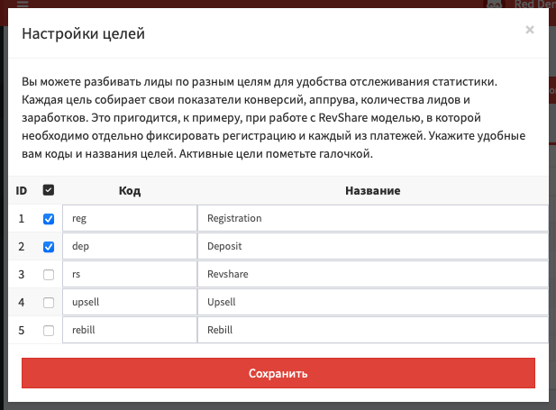
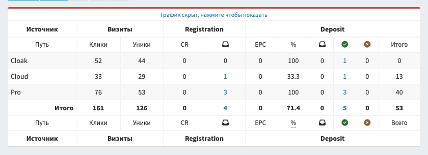

# Цели

В дополнение к основным статусам, вы можете дополнительно разбивать лиды на пять различных целей. Это полезно при работе с офферами, в которых по одному клику может быть создано несколько лидов. Например, в RevShare-модели вам нужно отдельно собирать регистрации и каждый из платежей.

## Настройка целей

Цели можно настроить в разделах "[Статистика](/track-stats)" и "[Лиды](/track-leads)". Перейдите в один из этих разделов и нажмите на кнопку "Цель" над табличкой.

Откроется всплывающее окно с настройками целей:

- **Галочка активности**: включает соответствующую цель.
- **Код**: определяет символьный код, который нужно использовать в параметре `goal` постбека.
- **Название**: используется в отчётах для визуального обозначения цели.

Вы можете одновременно использовать до пяти различных целей, плюс иметь лиды без указания цели. После активации целей, вы можете настроить особый вид раздела статистики.

## Статистика по целям

В разделе [статистики](/track-stats) вы можете включить дополнительные колонки для каждой из целей: показатели конверсии, EPC, аппрува, количество лидов по статусам, данные о финансах. При скачивании отчёта в Excel в нём всегда присутствуют все колонки статистики по целям.

Статистика по каждой цели использует следующие поля:

- Процент попадания лидов в цель, считается по общему количеству лидов.
- CR: процент конверсии из уникальных кликов в валидные лиды.
- EPC: соотношение суммы заработка к уникальным кликам.
- EPL: соотношение суммы заработка лидам в статусах холд и аппрув.
- Аппрув: соотношение количества подтвержденных лидов к количеству валидных лидов.
- Аппрув с учётом треша: соотношение подтвержденных лидов к общему количеству лидов.
- Общее количество поступивших лидов.
- Валидные лиды: количество поступивших лидов без учёта треша.
- Количество лидов по статусам: новые, холд, аппрув, отмена и треш.
- Финансы: общая сумма за лиды в статусах холд и аппрув, отдельные суммы по этим статусам.

> **Пример**: при работе с вертикалями гемблинга и беттинга вам может пригодится особая настройка колонок. Отключите все галочки конверсии, лидов и финансов без привязки к целям. Создайте две цели - регистрацию и депозит. Для цели "Регистрация" включите конверсию и общее количество лидов. Для цели "Депозит" включите EPC, аппрув, количество лидов в статусах "Холд", "Аппрув" и "Треш", а также финансовые показатели.

## Особенности постбеков

При использовании целей, важно помнить, что разные цели не создают новый лид по одному и тому же клику. Чтобы создавать новые лиды, добавьте в постбек уникальный параметр `uid`.

> **Пример 1**: при работе с регистрациями и платежами вам необходимо создавать от отдельные лиды на регистрацию и депозит. Для регистрации вы можете использовать `uid=reg`, для депозита `uid=dep` или конкретный идентификатор платежа.

При работе с SOI-целями, не забывайте добавлять в постбек `status=approve`, иначе лиды будут создаваться в статусе "Новый" и финансы по ним не будут суммироваться.

> **Пример 2**: при работе с учётом выкупа и возврата вам не нужно создавать новый лид в момент оплаты заказа. Достаточно использовать `uid` со значением ID заказа на стороне партнёрской сети, и лид просто поменяет свою цель на "Выкуп".
