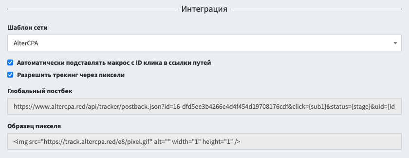

# Постбеки и интеграция

Отслеживание трафика выполняется с помощью постбек-запросов. Постбек может создать лид по ID клика или ID потока. Если вам нужна интеграция без постбеков, изучите инструкцию по [трекингу с помощью пикселей](pixel.md).

## Интеграция

Трекер содержит готовые шаблоны интеграции с популярными партнёрскими сетями и платформами. В настройках потока перейдите к блоку "Интеграция" и выберите интересующую вас сеть.



В настройках интеграции поставьте галочку "**Автоматически добавлять ID клика к ссылке**" и все ссылки в потоках будут подстроены под выбранную сеть. Вы можете настроить ссылки вручную, для этого укажите в них макрос `{click}` для нашего ID клика. При работе с [локальными сайтами](sites.md), добавьте поле с этим макросом в форму - он подставится автоматически.

```html
<input type="hidden" name="subid" value="{click}" />
```

После выбора сети, в блоке интеграции будут показаны образцы постбеков. Их нужно внести в настройки сети в соответствующие поля, например, в глобальный постбек или постбеки на депозит и регистрацию.

## Ручная настройка постбека

Вы можете составить постбек-запрос самостоятельно. Образец постбека с вашим кодом и параметрами для ID клика показан в разделе интеграции.

```
https://domain.com/postbacks/TOKEN?click={click}
```

Доступные параметры запроса:

- `click` - ID клика из нашего трекера.
- `uid` - уникальный ID лида на стороне партнёрской сети.
- `status` - статус лида: `new`, `hold`, `approve`, `cancel`, `trash`.
- `goal` - символьный [идентификатор цели](goal.md).
- `create=1` - создавать новый лид при каждом получении постбека.
- `price` - сумма выплаты за лид.
- `currency` - трехбуквенный ISO-код валюты, в которой выполняется выплата.
- `name`, `phone`, `email`, `comment`, `geo`, `ip` - данные лида.
- `utm_source`, `utm_campaign`, `utm_content`, `utm_term`, `utm_medium`, `subid`, `domain`, `adid`, `data1`, `data2` - метки лида, которые заменяют полученные из клика.

Полный список параметров и возможные форматы ответа вы можете изучить в разделе [API о функции постбека](api-tracker.md#postback).

## Работа с нестандартными статусами

Трекер умеет распознавать статусы автоматически и подстраивается под большую часть партнёрских сетей. Но иногда полезно указать, какие статусы считать новым заказом, какие воспринимать за аппрув, что отправлять в треш.

Для указания особых статусов, используются следующие параметры:

- `stn` - список статусов нового лида.
- `sth` - список статусов, попадающих в холд.
- `sta` - список статусов, которые распознаются как аппрув.
- `stc` - список статусов валидной отмены.
- `stt` - список треш-статусов.

Каждый параметр может содержать как один статус, так и несколько статусов через запятую. Статусы срабатывают без учета регистра и спецсимволов.

> **Важно!** Статус `hold` в нашем трекере - это **не статус ожидания**. Это отложенное подтверждение - лиды, которые подтверждены, но ещё не оплачены. Он участвует в подсчёте аппрува и EPC. Не используйте его как ожидание.

Например, при работе с сетью КМА используются статусы: `A` - аппрув, `D` - отмена, `F` - треш, `P` - новый заказ. Параметры будут выглядеть так:

```
stn=P&sta=A&stc=D&stt=F
```

## Работа с данными покупателя

Трекер позволяет собирать и хранить данные покупателей, которые они вводят на сайтах. Вы можете убрать постбек на новый лид из партнёрской сети и вместо него отправлять новый лид в трекер со страницы спасибо.

Вам доступны следующие поля:

- `name` - полное имя покупателя.
- `phone` - телефон покупателя (сохраняется без валидации и очистки).
- `email` - почта покупателя, (сохраняется без корректировки и валидации).
- `comment` - произвольный комментарий к заказу.
- `meta[xxx]` - произвольное поле с названием `xxx` (не экспортируется в Excel, доступно только в расширенной информации и по API).

> **Лайфхак**: вы можете отправлять лиды в партнёрскую сеть, используя постбек на создание лида в настройках потока. Подробнее об этой форме извращения рассказано [здесь](tags.md#send).

## Работа без ID клика

Работа с лидами может выполняться в двух вариантах - по ID клика или по ID потока. Второй вариант может пригодиться в тех ситуациях, где нет понятия перехода по ссылке, например, при работе с приложениями.

При работе с ID клика, вам необходимо указать его в параметре `click`. При работе с ID потока, вам нужно указать параметры `flow` с символьным ID потока и `subid` с уникальным ID лида.

Использование `subid` при этом строго обязательно. Именно `subid` используется для определения уникальных лидов. Данные о гео, IP-адресе и метках рекомендуется отправлять в постбеке.

## Журнал постбеков

Все постбеки, которые поступают в трекера по вашим лидам, сохраняются в подразделе "Входящие постбеки" раздела "Журналы". Вам доступны следующие сведения о постбеках:

- **Время получения постбека** - вы можете искать постбеки по диапазону дат, когда они были получены.
- **Поток**, **клик**, **лид** и **сайт** - идентификаторы из лида, по которому отправлялся постбек. Вы можете отфильтровать постбеки по конкретному идентификатору.
- **Статус**, который был указан у лида после обработки постбека. Даже если статус не менялся в запросе.
- **Ошибка** - результат выполнения постбека:
  - `access` - доступ к клику или потоку с этим идентификатором запрещён.
  - `bad-click` - отправлен некорректный ID клика.
  - `bad-flow` - отправлен некорректный ID потока.
  - `db` - во время обработки произошла ошибка базы данных.
  - `no-changes` - не потребовалось никаких изменений (возможно, не ошибка).
  - `no-click` - не отправлены ни ID клика, ни ID потока.

Вы можете посмотреть подробные данные о запросе, если нажмёте на "Показать" в столбце "Инфо":

- **URL** - полная ссылка, по которой выполнялся запрос.
- **GET** - расшифровка данных из GET-части запроса. Всегда показывается в JSON-представлении.
- **POST** - данные в блоке POST, которые были отправлены на сервер. Для показа данных всегда используется JSON-представление, потому что оно красиво выглядит.
- **Ответ сервера** - данные, которые отправил сервер в ответ на запрос.
- **IP**, **браузер** и **User-Agent** - информация о сервере, который совершил запрос.
