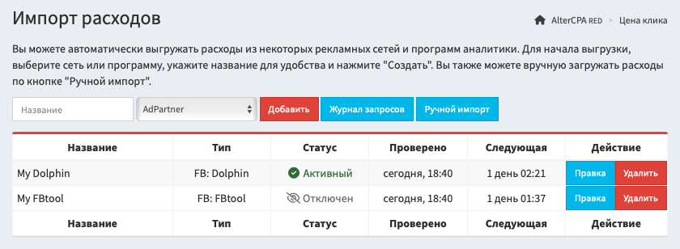

# Анатилика расходов

Трекер позволяет вам вести учёт расходов на рекламу и анализировать ROI ваших рекламных кампаний. Информация о цене клика может быть получена по ссылке, загружена по API или выгружена напрямую из сторонних сервисов аналитики.

## Методы работы

Вы можете использовать четыре метода импорта расходов в трекер:

- [Автоматический импорт](#auto) позволяет настроить подключение к рекламным сетям и системам аналитики, и выгружать данные о расходах по расписанию через их API.
- [Добавление по ссылке](#link) удобно для тизерных сетей, которые умеют передавать цену клика напрямую в ссылке, на которую направляют посетителя.
- [Ручная загрузка](#manual) пригодится для тестирования самих механизмов подсчёта ROI или для работы с сетями, в которых выгрузка расхода недоступна в принципе.
- [Работа по API](#api) - это автоматизированная реализация ручной загрузки, с которой вы можете выгружать данные из сервисов, например, через постбек-запросы.

Вы можете использовать все эти методы одновременно для разных источников. Но обязательно настройте сами ссылки потоков.

[Показать примеры](#example)



> **Крайне важно!** Выгрузка расходов не будет работать сама по себе, она требует особой настройки ссылок. Вы обязательно должны отправлять в одну из UTM-меток идентификатор креатива, объявления или адсета, по которому в будущем будете выгружать статистику. Иначе мы просто не сможем сопоставить ваши клики с выгрузкой финансов.

<a id="auto"></a>

## Автоматический импорт

Подключение сервисов для автоматического импорта выполняется в разделе "[Расходы](/track-spend)". Чтобы добавить новую выгрузку, укажите название и выберите сервис из выпадающего списка. Количество сервисов для выгрузки не ограничено.

Все методы выгрузки расходов имеют некоторые общие настройки, одинаковые для всех сервисов:

- **Выгрузка расходов включена** - активирует расписание выгрузки.
- **Название** - используется для удобства поиска.
- **Настройки доступа** - API-ключи, логины и пароли, которые необходимы для работы выгрузки, свои у каждого сервиса.
- **Расписание проверки** - от ежечасного до проверки раз в три дня. Общая рекомендация - проверять дважды в день.
- **Период выгрузки** - время, за которое извлекаются данные. Оптимальный вариант - выгружать за вчера и сегодня.
- **Фильтр по источнику** - будет применять ценники только к выбранному `utm_source`, что удобно для разделения источников трафика.
- **Привязка метки к параметру** - позволяет указать, в какую UTM-метку вы отправляете нужный параметр и какой это параметр. Например, это может быть ID объявления в метке `utm_content`.

Как правило, все выгрузки настраиваются одинаковым образом:

1. Создайте выгрузку нужной вам рекламной сети.
2. Укажите API-ключ этой сети.
3. Выберите выгрузку дважды в день за вчера и сегодня.
4. Укажите метку `utm_source`, с которой вы заливаете с этого источника.
5. Укажите `utm_content` в качестве основной метки и отправляйте в неё ID вашего креатива.

С этими общими рекомендациями будет работать большинство сетей.

<a id="link"></a>

## Добавление по ссылке

При работе с тизерными сетями, вы можете передавать цену клика напрямую в строке запроса. Для этого используйте два параметра:

- `cpc` - цена клика в выбранной вами валюте с точностью до 6 знаков.
- `cur` - валюта цены клика, по умолчанию используется `usd`.

Рекомендуется использовать этот подход при работе с редиректами. В иных случаях пользователь может случайно обновить страницу и тем самым добавить дополнительный ценник к клику.

<a id="manual"></a>

## Ручная загрузка

Вы можете указать расходы за период вручную. Для этого в разделе "[Расходы](/track-spend)" перейдите на вкладку "[Ручной импорт](/track-spend/manual)" и заполните форму.

Укажите расходы одним из методов - общая сумма или цена за один клик.

- **Общий расход** - сумма, которую вы потратили на все клики. При этом каждому клику сумма будет назначена равномерно.
- **Цена клика** - одинаковая сумма за один клик.
- **Валюта** - по умолчанию используется USD, но вы можете указать ценники в любой валюте, они будут пересчитываться автоматически при просмотре статистики.

Укажите критерии, по которым назначается ценник. Нужен хотя бы один критерий:

- **Дата с-по** - диапазон дат, за которые указывается цена клика.
- **Поток** и **гео**, по которым поступили клики.
- **UTM-метки**, **домен** и **SubID** - метки, по которым можно фильтровать клики и добавлять данные по конкретным объявлениям и кампаниям.
- **Только валидные клики** - при работе с фильтрами трафика, цена клика будет записана в клики, которые не были отправлены на трафикбек.
- **Только уникальные клики** - повторные визиты не получат свой ценник.

<a id="api"></a>

## Работа через API

API реализуют такой же механизм, как и ручной импорт цены клика. Вы можете загружать общую цену или цену за один клик с фильтрацией по датам, потокам, путям и меткам. Полная документация доступна в разделе [API](api-tracker.md#spend).

[Документация по API](api-tracker.md#spend)

<a id="example"></a>

## Рекомендации по настройке

В этом разделе мы собрали рекомендации по подключению к различным рекламным источникам. Для Facebook используйте [Dolphin](#dolphin) или [FBtool](#fbtool).

<a id="adpartner"></a>

### AdPartner

- **Метод работы**: автоматическая выгрузка.
- **Рекомендуемый период проверки**: вчера и сегодня.
- **Рекомендуемая частота проверки**: трижды в день.

Для интеграции с AdPartner укажите свой API-ключ.

<a id="directadvert"></a>

### DirectAdvert

- **Метод работы**: передача цены клика в ссылке.
- **Хвост ссылки**: `&cpc={CLICK_PRICE}`

Ваша ссылка будет выглядеть примерно так:

```
https://track.altercpa.one/face?utm_source=directadvert&utm_medium={SRC_ID}&utm_content={AD_ID}&cpc={CLICK_PRICE}
```

<a id="dolphincl"></a>

### Facebook через Dolphin Cloud

- **Метод работы**: автоматическая выгрузка.
- **Рекомендуемый период проверки**: вчера и сегодня.
- **Рекомендуемая частота проверки**: трижды в день.

Для интеграции с Dolphin Cloud укажите токен. Токен можно взять на странице [https://cloud.dolphin.tech/app/fb/settings](https://cloud.dolphin.tech/app/fb/settings), в поле "Токен авторизации для интеграций".

Для выгрузки статистики используйте `utm_content`, который должен быть указан так:

- **Выгрузка по ID кампании**: `utm_content={{campaign.id}}`
- **Выгрузка по ID адсета**: `utm_content={{adset.id}}`
- **Выгрузка по ID объявления**: `utm_content={{ad.id}}`

<a id="dolphin"></a>

### Facebook через серверный Dolphin

- **Метод работы**: автоматическая выгрузка.
- **Рекомендуемый период проверки**: вчера и сегодня.
- **Рекомендуемая частота проверки**: трижды в день.

Для интеграции с Dolphin укажите URL, где он установлен, в формате `http://site.com/`. Для получения токена, воспользуйтесь **[официальной инструкцией](https://documenter.getpostman.com/view/15402503/TzJrBJdk)**. Не используйте токен администратора, он не позволит выгружать статистику по другим пользователям. Каждый пользователь Dolphin должен добавить выгрузку самостоятельно.

Для выгрузки статистики используйте `utm_content`, который должен быть указан так:

- **Выгрузка по ID кампании**: `utm_content={{campaign.id}}`
- **Выгрузка по ID адсета**: `utm_content={{adset.id}}`
- **Выгрузка по ID объявления**: `utm_content={{ad.id}}`

<a id="fbtool"></a>

### Facebook через FBtool

- **Метод работы**: автоматическая выгрузка.
- **Рекомендуемый период проверки**: вчера и сегодня.
- **Рекомендуемая частота проверки**: дважды в день.

Для интеграции с FBtool укажите свой API-ключ. Вы можете указать список идентификаторов аккаунтов, по которым необходимо выводить статистику. Акакунты указываются через запятую. Если аккаунты не указаны, статистика выгружается по всем аккаунтам.

Для выгрузки статистики используйте `utm_content`, который должен быть указан так:

- **Выгрузка по ID кампании**: `utm_content={{campaign.id}}`
- **Выгрузка по ID адсета**: `utm_content={{adset.id}}`
- **Выгрузка по ID объявления**: `utm_content={{ad.id}}`

<a id="facebook"></a>

### Facebook напрямую

- **Метод работы**: автоматическая выгрузка.
- **Рекомендуемый период проверки**: вчера и сегодня.
- **Рекомендуемая частота проверки**: дважды в день.

Для интеграции с Facebook напрямую укажите свой API-токен. Зарегистрируйтесь на developers.facebook.com, создайте приложение типа Other - Business. После создагия переместитесь в Marketing API, в разделе Tools поставьте все галочки и нажмите Get Token. Рекомендуется указывать прокси для выгрузки данных.

Для выгрузки статистики используйте `utm_content`, который должен быть указан так:

- **Выгрузка по ID кампании**: `utm_content={{campaign.id}}`
- **Выгрузка по ID адсета**: `utm_content={{adset.id}}`
- **Выгрузка по ID объявления**: `utm_content={{ad.id}}`

<a id="mgid"></a>

### MGid

- **Метод работы**: автоматическая выгрузка.
- **Рекомендуемый период проверки**: вчера и сегодня.
- **Рекомендуемая частота проверки**: дважды в день.

Для интеграции с MGid укажите свои логин (email) и пароль. В поле UTM-метки выберите, в какую метку вы передаёте идентификатор рекламной кампании.

<a id="mixadvert"></a>

### MixAdvert

- **Метод работы**: автоматическая выгрузка.
- **Рекомендуемый период проверки**: вчера и сегодня.
- **Рекомендуемая частота проверки**: трижды в день.

Для интеграции с MixAdvert укажите свои логин и токен из раздела API.
