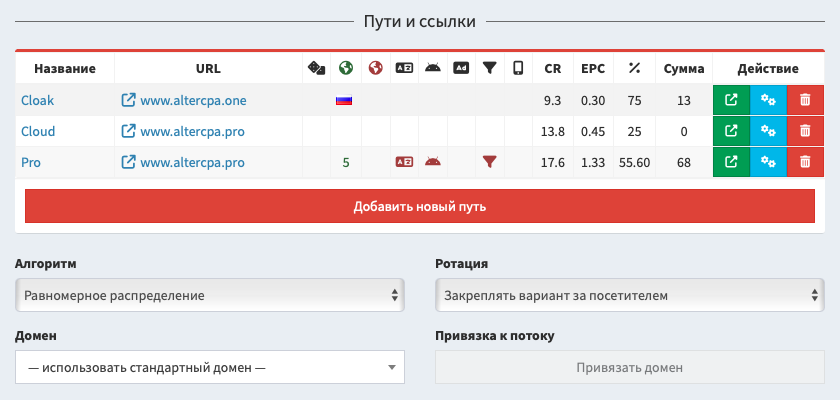

# Сплит-тестирование

Потоки позволяют проводить умное сплит-тестирование и создавать смартлинки. Оптимизация показов может выполняться по алгоритму многоруких бандитов. Сплит-тестирование встроено в любой поток.

[Смотреть видео на YouTube](https://www.youtube.com/watch?v=-NE4qJsGwc4)

## Множество путей

Каждый поток может состоять из множества путей. Количество путей на один поток не ограничено.

Первый путь всегда создается автоматически при добавлении потока. Чтобы создать путь в потоке, откройте его настройки и нажмите "Добавить новый путь". Вам нужно указать название и выбрать [сайт](sites.md) или ввести ссылку с [методом работы](method.md). Пути внутри потока могут одновременно работать с разными настройками ссылок и методов работы.

У пути доступны следующие настройки отображения содержимого:

- **Название** - используется для удобства поиска. У первого пути совпадает с названием потока.
- **Сайт** - привязанный к пути [сайт из хранилища](sites.md). Один сайт можно привязывать к любому числу путей, в том числе внутри одного потока.
- **URL** - если не выбран сайт, используется ссылка или путь к файлу.
- **Метод работы** - один из [доступных методов](method.md), по которому ведется работа со ссылкой.

В каждом пути можно указать свои индивидуальные настройки фильтрации. Если вам нужны идентичные принципы фильтрации для всех путей, просто укажите их в самом потоке, оставьте настройки пути пустыми. Доступны следующие фильтры:

- **Активные фильтры** - настройки [фильтрации трафика](filter.md) для выбранного пути.
- **Страны** - список гео, для которых показывается этот путь. Позволяет создавать разные пути под каждое гео.
- **Исключить страны** - список гео, для которых этот путь скрывается. Удобно для создания резервного пути.
- **Вероятность** - шанс показа именно этого пути. Указывается в процентах от 1 до 100. Если общая сумма всех вероятностей больше ста процентов, шансы нормализуются до сотни. Если меньше 100% - остаток разделяется между путями без указания вероятности.
- **Трафик** - устройства, для которых будет показываться этот путь: десктоп или мобильный.
- **Чёрный и белый списки URL** - фильтры по наличию или отсутствию ключевых слов в ссылке.

Вы можете дополнительно настроить "второй шаг" в пути. Если вы работаете со связкой прелендинг-лендинг, ваш прелендинг будет основным шагом пути, а лендинг - вторым. Не забудьте получить на прелендинге ссылку второго шага через макрос `{next}` в ссылке или коде сайта. Параметры второго шага аналогичны первому:

- **Сайт второго шага** - привязанный к пути [сайт из хранилища](sites.md).
- **URL второго шага** - если не выбран сайт, используется ссылка или путь к файлу.
- **Метод работы** - один из [доступных методов](method.md), по которому ведется работа со ссылкой.

При выборе пути, трекер анализирует все доступные по выбранным фильтрам варианты и распределяет визиты между ними. Если у путей не указаны вероятности, трафик распределяется равномерно. Трафик распределяется только между активными путями. Вы можете поставить деактивировать путь кнопкой "Пауза" в списке.

## Капы и лимиты

Вы можете ограничить посетителей, поступающих на каждый путь, с помощью капов и расписания работы. Капы задают максимальное количество лидов, которые путь готов принять за выбранный период. Доступные настройки:

- **Кап**: период, за который осуществляется подсчёт.
  - **Кап отключен** - количество лидов не ограничивается.
  - **24 часа** - считаем лиды за 24 часа от текущего момента.
  - **Начиная с полуночи** - считаем лиды за текущий календарный день.
  - **Неделя** - считаем лиды за 7 суток от текущего момента (не с полуночи).
  - **Месяц** - считаем лиды за 30 суток от текущего момента.
  - **Год** - считаем лиды за 356 суток от текущего момента.
  - **За любое время** - считаем все лиды за всё время жизни пути.
  - **В рабочее время** - считаем только лиды за прошлый период рабочего времени.
- **Статус**: лиды подсчитываются только в выбранных статусах.
  - **Любые лиды** - статусы не учитываются при подсчёте.
  - **Только валидные лиды** - статусы "Новый", "Холд", "Аппрув" и "Отмена".
  - **Лиды в ожидании** - только статус "Новый".
  - **Подтверждённые лиды** - только статус "Аппрув".
  - **Аппрув и холд** - статусы "Холд" и "Аппрув".
  - **Любые лиды кроме отменённых** - статусы "Новый", "Холд" и "Аппрув".
- **Лимит**: количество лидов выбранного статуса за выбранный период, которое допустимо для работы пути.

Лимит не гарантирует идеальную точность по количеству лидов. Если посетитель прошел по пути и оставил лид через несколько минут после этого, за эти несколько минут может прийти новый посетитель и оказаться на том же пути, также отправив новый лид.

Вы также можете задать расписание работы самого пути, например, в зависимости от доступности вашего колл-центра:

- **Дни недели**: вы можете указать конкретные дни, в которые путь будет активен.
- **Расписание**: указывается время начала и окончания активности пути, часы и минуты отдельно.
- **Часовой пояс**: заменяет системный часовой пояс для расчёта расписания и дней недели.

При сочетании дней недели и расписания по времени, мы учитываем именно начало рабочего периода. Например, если у вас выбрана пятница с 23:00 до 02:00, путь активируется в 23:00 в пятницу и будет работать до 02:00 субботы.

## Алгоритмы оптимизации

При равномерном распределении трафика есть шанс потерять большое количество визитов на неудачных вариантах. Чтобы избежать этих неприятностей, можно включить умный алгоритм распределения по методу многоруких бандитов. Для этого в настройках потока сразу под списком путей выберите особый алгоритм вместо "Равномерного распределения".

Вам доступны несколько алгоритмов оптимизации:

- **Приоритет конверсии**: учитывает соотношение валидных лидов к количеству уникальных кликов.
- **Приоритет конверсии в аппрув**: учитывает соотношение подтверждённых лидов к уникальным кликам.
- **Приоритет EPC**: учитывает соотношение заработка на подтверждённых лидах к количеству уникальных кликов.
- **Приоритет аппрува**: учитывает соотношение количества подтверждённых лидов к количеству валидный лидов.
- **Приоритет заработка**: учитывает общую сумму заработка по выбранному пути за всё время.
- **Приоритет конверсии по гео**: рассчитывает приоритет конверсии отдельно для каждого гео.
- **Приоритет EPC по гео**: рассчитывает приоритет EPC отдельно для каждого гео.

Показатели подсчитываются за последние три дня (72 часа) и обновляются раз в десять минут при наличии трафика.

Обратите внимание, что алгоритм мноноруких бандитов лишь отдаёт больше трафика некоторым путям, а не переводит трафик на них целиком - он размазывается между всеми путями с указанным приоритетом. Вы можете отделить часть трафика и всегда направлять его только по лучшему пути. Для этого используйте параметр "**Лучший путь**" и процент трафика, который всегда пойдёт на лучший вариант. Оптимальное значение - 50% трафика.

По умолчанию выбранный вариант закрепляется за посетителем. Вы можете дополнительно увеличить охват вариантов и показывать новый доступный вариант при каждом визите посетителя. Это особенно удобно при создании смартлинков в вертикали дэйтинга.

Существует особая форма распределения кликов без оптимизации - тупое равномерное распределение. Данный подход направляет клики по очереди в каждый из доступных путей, игнорируя их вероятности, и практически идеально распределяет равное количество кликов на каждый путь. Будет работать только в сплит-тестах без дополнительных фильтров в путях. Даже такой подход иногда может дать чуть больше кликов на один из путей.

## Анализ успешности

В настройках путей сразу же показываются их текущие показатели успешности. Конверсия, EPC и аппрув подсчитываются за последние три дня начиная с полуночи. Сумма заработка подсчитывается за всё время. Показатели пересчитываются каждые 10 минут при наличии трафика.

Этих показателей достаточно, чтобы предварительно оценить, какой из вариантов теста работает лучше. Но для более глубокого анализа рекомендуется сравнивать данные за произвольный период и проверять количество лидов и кликов по каждому из путей.

1. Перейдите в раздел "[Потоки](/track-flows)" и найдите нужный вам поток.
2. Нажмите на кнопку "[Статистика](/track-stats)" выбранного потока.
3. В первом выпадающем списке фильтрации выберите группировку по полю "Путь".
4. Укажите удобный диапазон дат для анализа и сравнивайте успешность каждого из вариантов по всем доступным параметрам.

Дополнительно вы можете использовать [расширенные фильтры](stats.md), чтобы просмотреть статистику по определенным гео, устройствам и меткам.
