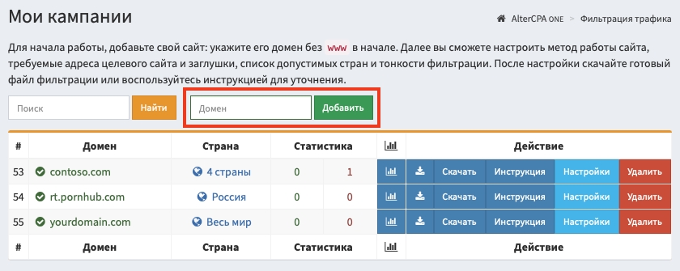
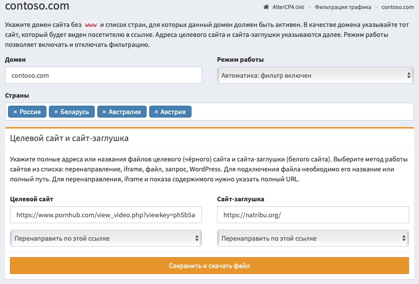

# Работа с кампаниями

::: card
### Краткое содержание раздела

1. Перейдите в "[Мои кампании](/filter)", укажите домен в зелёном поле "Домен", нажмите **"Добавить"**.
2. Выберите страны, из которых ожидаете визиты.
3. Укажите названия файлов или полные URL вашего целевого сайта и сайта-заглушки.
4. Выберите метод работы: редирект, подключение файла, iframe, CURL-запрос, WordPress.
5. Нажмите **"Сохранить и скачать файл"** и разместите файл на хостинге.

[Всё ясно, приступаем к работе!](/filter)
:::

## Добавление кампании

Начните свою работу с добавления кампании. "Кампания" - это ваши настройки фильтрации трафика. Работа с кампаниями осуществляется в разделе "[Мои кампании](/filter)".

Для создания кампании, укажите её домен или название и нажмите "Добавить". При использовании домена, он указывается без www в начале.

После добавления кампании, вам необходимо настроить основные параметры фильтрации трафика:

- **Домен**. На этом домене будет располагаться ваш файл фильтрации трафика. Вместо домена можно указать название кампании, но в таком случае не убирайте галочку "Игнорировать домен" в расширенных настройках.
- **Режим работы**. Используйте "Автоматику" для реальных задач и "Режим обучения" для тестирования.
- **Список стран**. Рекомендуем указать список стран, посетителей из которых вы ожидаете.
- **Целевой сайт и сайт заглушка**. Укажите файлы или URL соответствующих сайтов и их режим работы. Подробнее о них рассказано [здесь](code.md).

Нажмите "Сохранить и скачать файл", разместите полученный файл на своём хостинге для выбранного домена.

> **Важно!** Если вы меняете метод работы сайта-заглушки или целевого сайта, вам нужно повторно скачать новый файл фильтра! При смене иных настроек, например, ссылок или фильтров, новый файл скачивать не нужно.

## Настройка кампании

Вы можете указать дополнительные настройки кампании, которые могут не совпадать с нашим видением идеально простой фильтрации.

### Основные параметры

- **Домен** - будет использоваться для установки самого фильтра трафика одним из удобных способов. Обратите внимание, что это не домен вашего целевого сайта, потому что фильтр вероятнее всего будет ставиться на совсем другом домене. ***Интересный факт**: на самом деле, поле "домен" может быть любым. Реально он используется только для проверки заголовков (хост или реферер) входящего трафика. Но вы можете поставить в настройках сайта галочку «Игнорировать домен» и указывать любой текст.*
- **Режим работы** фильтра определяет, включена ли фильтрация:
  - **Автоматический режим**: фильтр включен и проверяет трафик.
  - **Пауза**: всегда показывает сайт-заглушку, данные о визитах не сохраняются.
  - **Выключен**: всегда показывает целевой сайт, данные о визитах не сохраняются.
  - **Обучение с заглушкой**: всегда показывает сайт-заглушку, но при этом сохраняет в журнале реальные данные о визитах и реальные ответы сервера фильтрации.
  - **Обучение с целевым**: всегда показывает целевой сайт с сохранением данных о визитах.
- **Страны** - вы можете ограничить список стран, визиты из которых будут попадать на целевой сайт. Если ни одна страна не выбрана, то трафик будет поступать независимо от его географии. Мы настоятельно рекомендуем указывать ограниченный список стран, чтобы отфильтровать визиты ботов, расположенных на удаленных серверах.
- **Целевой сайт и сайт-заглушка** - в этих полях вам необходимо указать URL или название файла (только при работе с подключением файла). [Подробнее о целевом сайте и заглушке](code.md).
- **Метод работы сайтов** - выберите метод показа целевого сайта и заглушки. В зависимости от выбранных методов, мы сформируем готовый файл фильтрации. **При смене метода, обязательно скачайте новый файл фильтрации!** [Подробнее о методах](code.md).

### Дополнительные параметры

- **Мусорные визиты** - фильтр отбросит указанное в этом поле число визитов и покажет им сайт-заглушку. Полезно при тестировании фильтра. С каждым заходом цифра в этом поле будет уменьшаться.
- **Версия IP-протокола** - вы можете допускать на свой сайт только посетителей, которые заходят по IPv4 или IPv6-протоколу. Полезно для организации IPv6-ханипота.
- **Трафик** - вы можете ограничить список устройств, с которых будет поступать трафик. На выбор есть десктоп-трафик и мобильный трафик (любой, iOS и не iOS)
- **Операционные системы** - список ОС, с которых разрешен трафик. Если ОС не распознана, она блокируется всегда.
- **Браузеры** - список браузеров, с которых разрешен трафик. Если браузер не распознан, он блокируется всегда.
- **Игнорировать домен запроса** - может пригодиться, если используете один и тот же сайт для работы с несколькими доменами или по API без учета реального домена.
- **Проверять только основной IP-адрес** - фильтр будет анализировать исключительно основной IP-адрес и не заблокирует случайно ваш фронт-сервер или CloudFlare.
- **Проверять язык посетителя** - фильтр проверит заголовок языка пользователя и сверит его с языками из списка допустимых стран. Позволяет отсеить большинство злоумышленников.
- **Проверять клик рекламы** - фильтр проверит наличие в запросе идентификатора рекламного клика популярных сетей. Проверяется именно наличие параметров, а не их корректность. Примеры параметров: `fbclid`, `adclid`, `gclid`, `wbraid`, `gbraid`, `msclkid` и другие.
- **Фильтры** - лучше оставьте это поле пустым. Вы можете ограничить список используемых фильтров, по которым будет производиться отбор трафика. Если не указан ни один фильтр, то фильтрация будет производиться по всем доступным вам чёрным спискам. Это оптимальный вариант для большинства случаев.
- **Список допустимых языков** - вы можете указать свой собственный список языков, с которыми посетители будут допущены на сайт. По умолчанию список языков формируется по списку стран.
- **Исключить страны** - вы можете использовать страны-исключения вместо стран, которым разрешен показ сайта. При этом не будут работать фильтры по языку, укажите допустимые языки самостоятельно.
- **Блокировать трафик, если URL содержит** - чёрный список слов в URL запроса. Указывается по одному слову в строке. Если слово попадётся в ссылке, трафик будет заблокирован и отправится на сайт-заглушку.
- **Пропускать трафик, если URL содержит** - белый список слов в URL запроса. Указывается по одному слову в строке. Если запрос не содержит ни одного из слов этого списка, трафик будет заблокирован.
- **Белый список** - запросы с указанных адресов не будут проверяться. Указывается по одному адресу в строке. Можно указывать как единичный адрес (12.34.56.78), так и подсеть с числовой маской (12.34.56.0/24).

::: card

## Системные чёрные списки

Вам доступен ряд системных фильтров, которые можно использовать в своих сайтах.

- **AlterCPA Lite** типа **IPv4**, **IPv6** и **Net** - статичные чёрные списки адресов прокси-серверов и подозрительных провайдеров. Формируются несколько раз в час на основании сканирования адресов Всемирной сети и чёрных списков от наших поставщиков.
- **Smart** типа **IPv4**, **IPv6** и **Net** - умные чёрные списки, которые формируются в реальном времени автоматически на основании поступающего трафика по всем сайтам сервиса.

Для оптимальной защиты вашего сайта от паразитного трафика мы рекомендуем использовать все доступные фильтры, то есть не настраивать поле "Фильтры" вообще.

[Узнать больше о чёрных списках](blacklist.md)
:::
