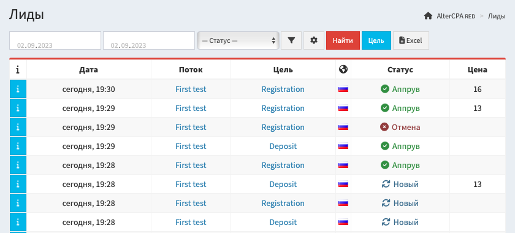
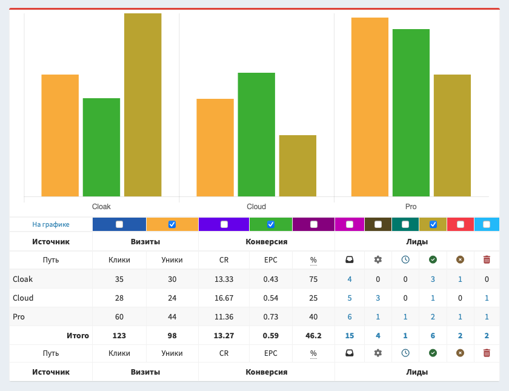
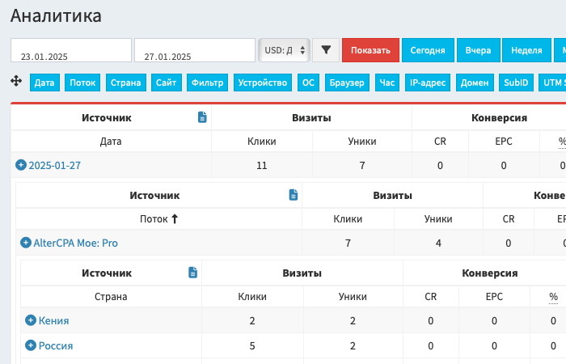
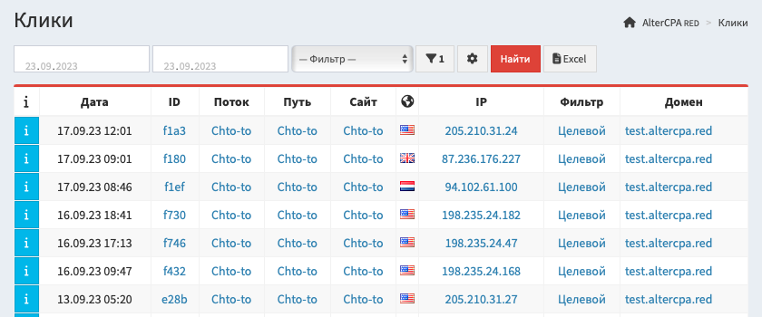

# Статистика и аналитика

Трекер предоставляет два основных раздела статистики - подробные данные о лидах и сводная статистика по кликам. Подробные данные о кликах доступны в журнале.

> **Важно!** Статистику можно смотреть не только по датам! Просто выберите нужный вам критерий в первом выпадающем списке фильтров. При работе с мобильного устройства откройте настройки фильтрации по кнопке. И вам откроется полный комплект всех доступных меток, по которым можно сгруппировать статистику.

## Статистика по лидам

Все поступающие по постбекам заявки собираются в разделе "[Лиды](/track-leads)" трекера.

Все лиды организованы в таблицу, в которой показаны следующие сведения:

- Дата поступления лида в трекер. Она не меняется при изменении статуса лида.
- Поток и путь, по которому поступил этот лид.
- Сайт из хранилища, если он использовался при отправке лида.
- Внутренний статус лида (новый, холд, аппрув, отмена или треш) и реальный статус, который был получен в постбеке.
- Страна и IP-адрес поступления лида.
- Цена лида (отображается независимо от статуса).
- Данные об источнике лида: домен, subid, UTM-метки.
- Внутренние данные лида: имя, телефон, почта, комментарий.

Вы можете выбирать видимость столбцов в таблице по кнопке с шестерёнкой. Независимо от того, какие столбцы выбраны у вас в отчёте, при скачивании файла в Excel в нём будут все доступные данные.

> **Важно!** Статус `hold` в нашем трекере - это **не статус ожидания**. Это отложенное подтверждение - лиды, которые подтверждены, но ещё не оплачены. Он участвует в подсчёте аппрува и EPC. Не используйте его как ожидание.

По кнопке `[i]` вы можете просмотреть дополнительную информацию о поступившем лиде:

- Идентификатор клика, по которому поступил лид.
- User-Agent и вычисленные на его основе браузер и операционную систему.
- Дополнительные поля лида, переданные при создании.

Поиск лидов осуществляется по дате их поступления и статусу. Чтобы искать лиды по другим критериям, нажмите на кнопку с воронкой и перед вами откроется форма расширенного поиска. В ней доступны: поток, гео, сайт, цель, домен, метки, IP, ID лида, устройства и результаты фильтрации.

## Статистика по кликам

Сводная аналитика по кликам и лидам доступна в разделе "[Статистика](/track-stats)". В ней собираются данные о ваших визитах и лидах.

Отчёт статистики формируется по одному из выбранных параметров:

- **Время поступления лида**: Дата и Час.
- **Источник лида**: Поток, Путь и Сайт.
- **Результат фильтрации трафика**: Фильтр.
- **География лида**: Страна и IP-адре.с
- **Отправитель лида**: Устройство, ОС, Браузер.
- **Метки**: Домен, SubID, UTM Source, UTM Content, UTM Term, UTM Medium.

Вы можете выбрать период показа отчёта по выбранному параметру и валюту, в которой будут выводиться суммы. По кнопке с воронкой откроется список расширенных фильтров: потоки, гео, сайты, метки, устройства, фильтры. График по выбранному показателю скрыт по умолчанию, чтобы раскрыть его, нажмите на кнопку "Показать" в верхней части таблицы.

> **Важно!** Статус `hold` в нашем трекере - это **не статус ожидания**. Это отложенное подтверждение - лиды, которые подтверждены, но ещё не оплачены. Он участвует в подсчёте аппрува и EPC. Не используйте его как ожидание.

По умолчанию валюта лида вообще не берётся в расчёт и выплаты просто суммируются. При выборе валюты, все суммы пересчитываются в неё. Валюта по умолчанию - USD.

В таблице статистики используются следующие поля:

- Общее количество визитов и уникальные клики.
- Количество переходов на второй шаг (лендинг) и их процент от уникальных визитов.
- CR и CRt: процент конверсии из уникальных кликов в валидные и все лиды.
- EPC: соотношение суммы заработка к уникальным кликам.
- EPL: соотношение суммы заработка лидам в статусах холд и аппрув.
- Аппрув: соотношение количества подтвержденных лидов и холда к количеству валидных лидов.
- Аппрув с учётом треша: соотношение подтвержденных лидов и холда к общему количеству лидов.
- Общее количество поступивших лидов.
- Валидные лиды: количество поступивших лидов без учёта треша.
- Количество лидов по статусам: новые, холд, аппрув, отмена и треш.
- Финансы: общая сумма за лиды в статусах холд и аппрув, отдельные суммы по этим статусам.
- ROI: цена клика, суммы расхода и прибыли, процент заработка.
- CPL: итоговая цена любого, валидного (CPLv) и подтверждённого (CPLa) лида.

Если вы активируете поддержку целей, по каждой из целей также будут доступны:

- Показатели: CR, EPC, EPL, два вида аппрува.
- Количество лидов всего, валидных и по статусам.
- Финансы: общие, холд и аппрув.

Видимость колонок настраивается по кнопке с шестерёнками. Колонки с разбивкой по целям скрыты по умолчанию, вам нужно вручную выбрать их после активации цели.

## Аналитика трафика

Раздел аналитики - это альтернативный вариант отображения статистики кликов. Он позволяет иерархически организовать статистику и просматривать её в глубину. Графика на этом отчёте нет, но все фильтры и колонки - доступны.

Переместите метки мышкой в нужной вам последовательности и нажмите на галочку. Будет построен иерархический отчёт по указанной последовательности меток. Нажмите на плюсик в строке статистики, чтобы раскрыть её глубже. Если по какой-то из меток указан фильтр, она будет пропущена в иерархии.

::: card
## Настройка целей

При работе со статистикой, вы можете активировать поддержку целей. Цели позволят вам дополнительно разбить лиды по группам и анализировать необходимые показатели внутри этих групп.

[Узнать больше о целях](goal.md)
:::

## Журнал кликов

Все визиты, которые регистрирует трекер, сохраняются в журнале "Клики" трекера.

Клики организованы в таблицу, в которой показаны следующие сведения:

- Дата поступления клика в трекер.
- Идентификатор клика, по которому можно найти созданные лиды.
- Отметки уникального клика и перехода на второй шаг (лендинг).
- Поток, по которому поступил этот клик, и путь, куда он был направлен.
- Сайт из хранилища, если он использовался при отправке клика.
- Результаты фильтрации клика: валидный или заблокированный клик.
- Страна и IP-адрес поступления клика.
- Цена клика, если она была получена при визите или по API.
- Данные об источнике клика: домен, subid, UTM-метки.

Вы можете выбирать видимость столбцов в таблице по кнопке с шестерёнкой. Независимо от того, какие столбцы выбраны у вас в отчёте, при скачивании файла в Excel в нём будут все доступные данные.

По кнопке `[i]` вы можете просмотреть дополнительную информацию о поступившем клике:

- Идентификатор рекламного клика и дополнительные поля.
- User-Agent и вычисленные на его основе браузер и операционную систему.

Поиск кликов осуществляется по дате их поступления и статусу фильтрации. Чтобы искать клики по другим критериям, нажмите на кнопку с воронкой и перед вами откроется форма расширенного поиска. В ней доступны: поток, гео, сайт, цель, домен, метки, IP, ID клика, устройства.
