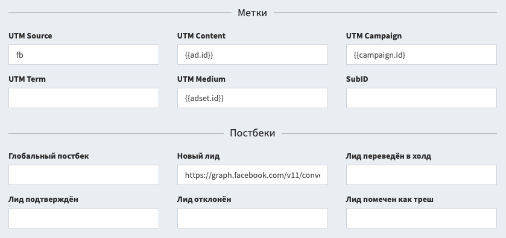

# Исходящие постбеки

Вы можете отправлять постбек-запросы в сторонние сервисы при изменении лидов. Это полезно для интеграции с различными рекламными сетями и оптимизации рекламы. Постбеки настраиваются внутри потока.

<a id="auto"></a>

## Автоматическая настройка по шаблону

Вам не обязательно заполнять все метки самостоятельно. В разделе "Метки" нажмите на "Настроить источник трафика", выберите нужный вариант и нажмите "Сохранить". Иногда, мы запросим с вас пару параметров:

- **Токен** - потребуется для отправки постбеков оптимизации. Чаше всего можно найти в личном кабинете или извлечь из образца постбека.
- **Домен** - в некоторых случаях, кроме токена меняется и домен для постбека. Извлекается из образца постбека, указывается только сам домен, не ссылка.
- **Пиксель** или **Идентификатор** - номер вашего счётчика или кампании, по которой идёт оптимизация.

После сохранения формы, все метки и постбеки подставятся автоматически. Просто скопируйте новую ссылку потока и используйте её для залива трафика.

<a id="tags"></a>

## Доступные метки

В настройках потока вы можете указать метки и макросы для отслеживания трафика. Вам доступны следующие параметры, которые собираются в статистике:

- Метка **SubID** и её параметр `subid`.
- Метка **UTM Source** и её параметр `utm_source`.
- Метка **UTM Campaign** и её параметр `utm_campaign`.
- Метка **UTM Content** и её параметр `utm_content`.
- Метка **UTM Term** и её параметр `utm_term`.
- Метка **UTM Medium** и её параметр `utm_medium`.
- Цена клика в параметре `cpc` и её валюта в параметре `currency`.

Статистика формируется только по этим шести меткам. Другие параметры и метки не учитываются при записи визита и не участвуют в создании статистики. Нет смысла использовать какие-нибудь `sub1` или `s2`, мы их не учтём.



Также вам доступны дополнительные параметры, которые не используются в статистике, но могут применяться в постбеках, например, для оптимизации мобильных приложений или рекламных сетей:

- Идентификатор рекламного клика из параметров: `fbclid`, `gclid`, `adclid`, `clid`, `adid`.
- Произвольные данные №1 из параметров `data1` или `d1`.
- Произвольные данные №2 из параметров `data2` или `d2`.
- Произвольные данные №3 из параметров `data3` или `d3`.
- Произвольные данные №4 из параметров `data4` или `d4`.
- Произвольные данные №5 из параметров `data5` или `d5`.

<a id="postback"></a>

## Доступные события

Вам доступно несколько вариантов настройки постбеков внутри потока:

- **Глобальный постбек**: срабатывает каждый раз, когда происходят какие-либо изменения с лидом, в том числе его создание и изменение любых параметров. Работает совместно с остальными постбеками, не заменяет их.
- **Новый лид**: срабатывает только в момент создания лида, независимо от того, в каком статусе и с какой целью этот лид создавался.
- **Лид переведён в холд, подтверждён, отклонён, помечен как треш**: срабатывают только при изменении статуса лида на выбранный, но не при создании лида в этом статусе.

## Доступные макросы

Данные вставляются в постбек с помощью макросов в фигурных скобках:

- `{id}` - числовой идентификатор лида.
- `{flow}` - символьный идентификатор потока.
- `{way}` - числовой идентификатор пути.
- `{site}` - числовой идентификатор сайта.
- `{click}` - символьный идентификатор клика.
- `{uid}` - уникальный идентификатор лида.
- `{time}` - время поступления лида в формате Unix Timestamp.
- `{now}` - текущее время в формате Unix Timestamp.
- `{utm_source}` - метка UTM Source.
- `{utm_campaign}` - метка UTM Campaign.
- `{utm_content}` - метка UTM Content.
- `{utm_term}` - метка UTM Term.
- `{utm_medium}` - метка UTM Medium.
- `{domain}` - домен.
- `{subid}` - метка SubID.
- `{adid}`, `{fbclid}`, `{gclid}`, `{adclid}`, `{clid}` - идентификатор клика в рекламной сети.
- `{data1}` - поле произвольных данных 1.
- `{data2}` - поле произвольных данных 2.
- `{data3}` - поле произвольных данных 3.
- `{data4}` - поле произвольных данных 4.
- `{data5}` - поле произвольных данных 5.
- `{status}` - стандартный статус лида (`new`, `hold`, `approve`, `cancel`, `trash`).
- `{custom}` - исходный текстовый статус лида.
- `{goal}` - символьный идентификатор цели.
- `{name}` - имя покупателя.
- `{phone}` - телефон покупателя.
- `{email}` - почта покупателя.
- `{comment}` - комментарий к заказу.
- `{geo}` - ISO-код страны лида.
- `{ip}` - IP-адрес лида.
- `{ua}` - User Agent.
- `{price}` - цена лида.
- `{currency}` - валюта цены лида (по умолчанию `usd`).
- `{meta:xxx}` - значение произвольного поля с названием `xxx`.

## События Facebook

Серверный пиксель для Facebook устанавливается в "Новый" постбек и может выглядеть следующим образом:

```
https://graph.facebook.com/v18.0/PIXEL/events|POST|access_token=TOKEN&data=[{"action_source":"website","event_name":"Lead","event_time":{now},"user_data":{"external_id":"{id}","client_ip_address":"{ip}","client_user_agent":"{ua}","fbc":"fb.1.{now}.{adid}","fbp":"fb.1.{now}.{id}"}}]
```

В этой ссылке нужно указать свои данные вместо текстов:

- `PIXEL` - идентификатор вашего пикселя, например `1234567890`.
- `TOKEN` - ваш токер, например `EAABabcde`.
- `Lead` - название события, которое вам необходимо отправить.

Указание ID пикселя и токена обязательно, менять событие - по желанию.

<a id="send"></a>

## Отправка лидов

Вы можете реализовать отправку лидов из трекера в партнёрскую сеть. Обратите внимание, что данный формат отправки не будет гарантированным или отслеживаемым. Мы не рекомендуем использовать этот метод в своей работе.

Создайте страницу "Спасибо", которая будет запрашивать стандартный постбек и передавать данные, указанные пользователем в форме на сайте. Для отправки лидов, заполните постбек "Новый лид" и укажите в нём все данные лида, которые вы собираете на странице "Спасибо". Например, такой постбек отправит лид в сеть на базе AlterCPA:

```
https://domain.com/api/wm/push.json?id=TOKEN&offer=1&flow=2&name={name}&phone={phone}&ip={ip}&country={geo}&sub1={click}
```

Возможно, этот формат отправки вам не подойдёт, поскольку целевая сеть принимает только POST-запросы. Чтобы их реализовать, воспользуйтесь следующей инструкцией.

## POST-запрос

По умолчанию постбеки отправляются как GET-запросы. При острой необходимости вы можете разделить постбек  на ссылку и POST-часть запроса. Для этого в середине ссылки вставьте макрос `|POST|`, перед которым будет ссылка (GET-часть запроса), а после которого будут идти данные. Например:

```
https://track.er/postback?code=abc|POST|click={click}&name={name}
```

Данные передаются в классическом URL Encoded формате, отправка JSON таким методом не поддерживается.

Если по какой-то причине вам необходимо отправить запрос именно в формате JSON, вместо макроса `|POST|` используйте макрос `|JSON|` с теми же принципами. Например:

```
https://track.er/postback|JSON|{"foo":"bar","click":"{click}"}
```

Этот макрос разделит ссылку на ссылку и JSON-часть и отправит запрос с заголовком `Content-type: application/json`.

> **Важно!** Учитывайте, что данный функционал был создан по приколу и мы не думаем, что вы всерьёз будете использовать его в своей работе. Вы же не будете? Правда? Упс.

## Журнал постбеков

Все постбеки, которые отправляются из трекера по ссылкам в потоке, сохраняются в подразделе "Исходящие постбеки" раздела "Журналы". Вам доступны следующие сведения о постбеках:

- **Время отправки постбека** - вы можете искать постбеки по диапазону дат, когда они были отправлены.
- **Событие постбека** - показывает, из какого поля был взят постбек.
- **Поток**, **клик**, **лид** и **сайт** - идентификаторы из лида, по которому отправлялся постбек. Вы можете отфильтровать постбеки по конкретному идентификатору.
- **Тип** - метод отправки постбека: классический GET либо POST в стандартном формате или JSON.
- **URL** - ссылка, на которую был отправлен запрос. Не копируйте эту ссылку для проверки, она содержит спецсимволы. Нажмите на "Показать" и скопируйте ссылку оттуда.
- **Код ответа** - хорошим кодом считается 200, отсутствие ответа - ноль, всё остальное зависит от целевого сайта.

Вы можете посмотреть подробные данные о запросе, если нажмёте на "Показать" в столбце "Инфо":

- **URL** - полная ссылка, по которой выполнялся запрос.
- **POST** - данные в блоке POST, которые были отправлены на сервер. Для показа данных всегда используется JSON-представление, потому что оно красиво выглядит. В реальности отправка данных также происходит в формате urlencoded, если не указан JSON-формат.
- **Ответ сервера** - данные, которые отправил сервер в ответ на запрос, без указания заголовков. Если сервер отвечает в JSON-формате, данные преобразуются для красивого отображения.
